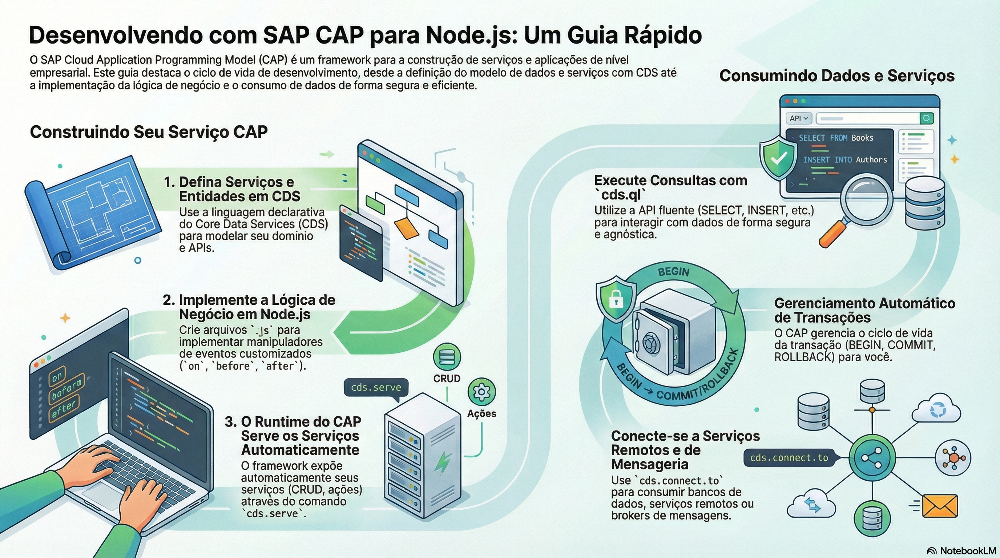

# Guia de Estudos SAP CAP com Node.js



> **Este repositório é um curso completo para desenvolvedores que desejam aprender e dominar o SAP Cloud Application Programming Model (CAP) com Node.js. Ele parte da primeira aplicação e segue até a produção, com slides guiados, infográficos e referências à documentação oficial.**

## Estrutura do Curso

São 6 módulos e 37 aulas, na ordem recomendada de estudo. Os módulos 1 a 4 seguem o caminho de uma aplicação real, do projeto vazio à produção, com interfaces Fiori e não Fiori no módulo 3. O módulo 5 trata da IA nativa do CAP, com MCP, agentes e embeddings, e o módulo 6 aprofunda SaaS, extensões e os internos do framework. As aulas seguem o CAP 10 (`@sap/cds` 10.2), com Node.js 22 ou superior e projetos em ESM.

| Módulo | Aulas | Descrição |
| :--- | :---: | :--- |
| **[Módulo 01: Fundamentos](./modulo-01-fundamentos/README.md)** | 5 | O que é o CAP, a primeira aplicação, a configuração e as decisões de modelagem com CDS. |
| **[Módulo 02: Serviços e Dados](./modulo-02-servicos-e-dados/README.md)** | 10 | Do contrato do serviço às regras de negócio, com dados, rascunhos, integrações e mensageria. |
| **[Módulo 03: Interfaces Fiori e Web](./modulo-03-interfaces/README.md)** | 8 | Telas com SAP Fiori Elements e interfaces web com UI5 Web Components, React, Vite e Angular. |
| **[Módulo 04: Segurança e Operação](./modulo-04-seguranca-e-operacao/README.md)** | 5 | Quem pode fazer o quê, proteção de dados pessoais, qualidade e o caminho até a produção. |
| **[Módulo 05: IA Nativa](./modulo-05-ia-nativa/README.md)** | 4 | Desenvolver com agentes de IA e levar agentes, MCP e embeddings para dentro da aplicação. |
| **[Módulo 06: Avançado](./modulo-06-avancado/README.md)** | 5 | SaaS, extensões, plugins e os internos do CAP: notações, compilador, reflexão e runtime. |

Todos os exemplos usam a livraria (*bookshop*) da documentação oficial, para que uma aula continue de onde a anterior parou.

## Aprenda Praticando - Projeto de Minha Autoria

Depois das aulas, veja os conceitos em um sistema completo: o **[Pedidos de Compras - SAP CAP / Node.js](https://github.com/AdrianoBispo/sap-cap-nodejs-pedidos-de-compras-app)**, um projeto de minha autoria que cobre o processo de compra de ponta a ponta.

- **Backend em CAP 10** com serviços OData V4, em duas versões equivalentes: JavaScript (ESM) e TypeScript `strict`, com tipos do `cds-typer`.
- **Oito aplicações SAPUI5:** quatro de gestão em Fiori Elements e quatro de análise em SAPUI5 *freestyle*, reunidas em um launchpad local.
- **Regras reais de negócio:** clientes com endereço pelo CEP, estoque, pedidos, pagamento simulado, reembolsos e importação por planilha.
- **Testes automatizados** nas duas versões.

## Como Estudar Cada Aula

Cada pasta de aula traz:

1. **Slides (`.pptx`):** o material principal, no Design System SAP Horizon, dividido em seções e com um resumo no último slide. As anotações do apresentador de cada slide apontam para a referência oficial.
2. **README:** objetivos, seções da aula e links para o Capire.
3. **Infográfico:** resumo visual para consulta rápida, nas aulas que têm um.

## Organização e Nomenclatura dos Arquivos

Nenhum nome de pasta ou arquivo usa espaços ou acentos, para facilitar o uso em terminais, links e URLs.

```text
modulo-01-fundamentos/
  README.md
  01-conceitos-e-primeira-aplicacao/
    01.01_Conceitos_e_primeira_aplicacao.pptx
    01.01_Infografico.png
    README.md
```

1. **Módulo:** `modulo-DD-slug`, em que `DD` é o número do módulo.
2. **Aula:** `SS-slug`, em que `SS` é o número da aula dentro do módulo.
3. **Arquivos:** `DD.SS_Titulo_da_aula.pptx` e `DD.SS_Infografico.png`, com o mesmo número da aula.

## Como Contribuir

Contribuições são bem-vindas! Se você encontrar erros, tiver sugestões de melhoria ou quiser adicionar novo conteúdo, siga estes passos:

1.  **Fork** este repositório.
2.  Crie uma nova **branch** para sua feature (`git checkout -b feature/nova-feature`).
3.  Faça suas alterações e **commit** (`git commit -m 'feat: Adiciona nova feature'`).
4.  Envie para a sua branch (`git push origin feature/nova-feature`).
5.  Abra um **Pull Request**.

## Links Úteis

  ### Documentação Oficial
  - [Capire - Documentação Oficial da SAP CAP](https://cap.cloud.sap/docs/)
  - [capire/bookshop - Exemplo usado nas aulas](https://github.com/capire/bookshop)

  ### Cursos Oficiais da SAP
  - [SAP Learning - Introduction to SAP Cloud Application Programming Model](https://learning.sap.com/courses/introduction-to-sap-cloud-application-programming-model)
  - [SAP Learning - Develop extensions with SAP Cloud Application Programming Model](https://learning.sap.com/courses/develop-extensions-with-sap-cloud-application-programming-model)
  - [SAP Learning - Desenvolva extensões com CAP seguindo o Guia do desenvolvedor SAP BTP](https://learning.sap.com/courses/develop-extensions-with-cap-following-the-sap-btp-developer-s-guide)
  - [SAP Learning - Desenvolvendo um aplicativo SAP Fiori Elements baseado em um serviço CAP OData V4](https://learning.sap.com/courses/developing-an-sap-fiori-elements-app-based-on-a-cap-odata-v4-service)

  ### Interfaces Web
  - [UI5 Web Components - Documentação oficial](https://ui5.github.io/webcomponents/docs/)
  - [UI5 Web Components for React](https://github.com/UI5/webcomponents-react)
  - [UI5 Web Components for Angular](https://sap.github.io/fundamental-ngx/)
  - [Soluções do curso de Fiori Elements com CAP (UX405)](https://github.com/SAP-samples/fiori-elements-v4-cap-advanced)
  - [SAP Fiori Elements Feature Showcase](https://github.com/SAP-samples/fiori-elements-feature-showcase)

  ### Tutoriais Oficiais da SAP
  - [Tutorial SAP - Crie um aplicativo de negócios CAP utilizando o VS Code e Nodejs](https://developers.sap.com/mission.cp-starter-extensions-cap.html)
  - [Tutorial SAP - Desenvolva uma aplicação CAP Full-Stack seguindo o Guia do Desenvolvedor SAP BTP](https://developers.sap.com/group.cap-application-full-stack.html)
  - [Tutorial SAP - Como Criar uma Aplicação SAP CAP Full Stack utilizando o BAS, Nodejs e Banco Hana](https://developers.sap.com/mission.hana-cloud-cap.html)
  - [Tutorial SAP - Desenvolva um aplicativo Node.js no SAP BTP Kyma Runtime](https://developers.sap.com/mission.cp-kyma-node-js.html)
  - [Tutorial SAP - Crie um aplicativo com Cloud Foundry Node.js Buildpack](https://developers.sap.com/tutorials/btp-cf-buildpacks-node-create.html)
  - [Tutorial SAP - Como desenvolver um App de Mensagens dentro do SAP BTP utilizando o Nodejs ou Java](https://developers.sap.com/mission.cp-enterprisemessaging-app-develop.html)

## Licença

Este projeto é distribuído sob a licença MIT. Veja o arquivo `LICENSE` para mais detalhes.

---

_Os slides foram escritos a partir da [documentação oficial do CAP (Capire)](https://cap.cloud.sap/docs/). Os infográficos foram gerados pelo Notebook LM com base na mesma documentação._
