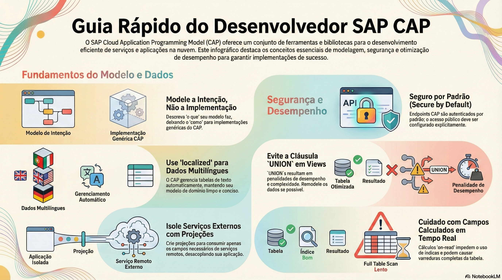

# Conceitos e primeira aplicação

> **Comece pelos slides: [Conceitos e primeira aplicação](./01.01_Conceitos_e_primeira_aplicacao.pptx)**
>
> **Referência oficial (Capire):** [Getting Started](https://cap.cloud.sap/docs/get-started/) · [Core Concepts](https://cap.cloud.sap/docs/get-started/concepts) · [Bookshop Sample](https://cap.cloud.sap/docs/get-started/bookshop)

Os blocos do framework e a livraria do zero: do cds init ao serviço no ar, com modelo, dados e o primeiro handler.

## O que você vai aprender

- O CAP reúne **linguagens, bibliotecas e ferramentas** e guia o projeto por boas práticas prontas
- **CDS** captura o domínio; os **runtimes** Node.js e Java usam o modelo para servir requisições
- Serviços são **interfaces** e fachadas para um caso de uso, sem guardar estado
- `cds init` cria o projeto, `cds watch` recarrega a cada arquivo salvo e `cds add` faz crescer
- Arquivos **CSV** em `db/data` seguem o padrão `namespace-Entidade.csv`
- Ações próprias precisam de um **handler** registrado com `this.on`

## Seções da aula

1. **Como o CAP pensa:** Os blocos do framework, o papel dos serviços e o que você recebe sem escrever código.
2. **O projeto:** O CAP prefere **convenção a configuração**: pastas com nomes padrão funcionam sem nenhum ajuste.
3. **Modelo e dados:** Ao salvar o modelo, o `cds watch` compila e implanta tudo em um **SQLite em memória**.
4. **Serviços:** Serviços são **orientados a casos de uso**: cada persona enxerga só o que precisa.
5. **Lógica própria:** Primeiro **declare** o que for possível. Escreva código para o que uma restrição não expressa.

---

[Voltar ao Módulo 01](../README.md) · Próxima aula: [01.02 Configuração e perfis](../../modulo-01-fundamentos/02-configuracao-e-perfis/README.md)
