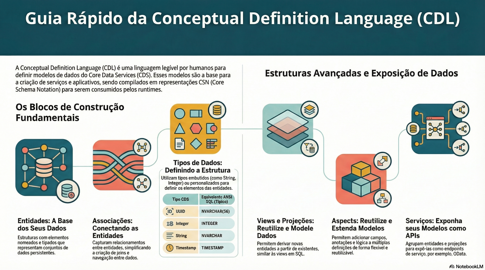

# Entidades, relações e tipos

> **Comece pelos slides: [Entidades, relações e tipos](./01.03_Entidades_relacoes_e_tipos.pptx)**
>
> **Referência oficial (Capire):** [Domain Modeling](https://cap.cloud.sap/docs/guides/domain/) · [CDL Reference](https://cap.cloud.sap/docs/cds/cdl) · [Core Types](https://cap.cloud.sap/docs/cds/types) · [Common Reuse Models](https://cap.cloud.sap/docs/cds/common)

Como escrever um modelo que captura a intenção: chaves, relacionamentos, documentos, tipos nativos e anotações.

## O que você vai aprender

- CDS captura **o quê**, não **como**; as implementações genéricas cuidam do resto
- Prefira chaves **simples, canônicas e UUID**, e nunca interprete um UUID
- Use associações **gerenciadas** para `to one`; para muitos exige `on` com `$self`
- Composições modelam documentos: deep insert, delete em cascata e exposição automática
- `cuid` e `managed` trazem chave UUID e auditoria, preenchidas pelo runtime
- Anotações agrupam-se por família: validação, acesso, serviços, persistência e OData

## Seções da aula

1. **Entidades e chaves:** Entidades representam os **dados do domínio** e viram tabelas no modelo de persistência.
2. **Associações:** Associações capturam **relacionamentos** entre entidades e substituem o que, em SQL, seriam chaves estrangeiras e joins escritos à mão.
3. **Composições:** Composições representam relações de **contido em**: os itens só existem dentro do documento que os contém.
4. **Tipos nativos:** O CDS tem poucos tipos, e cada um tem um **mapeamento** padrão para ANSI SQL.
5. **@sap/cds/common:** Um modelo enxuto, sem runtime especial, com **práticas recolhidas de aplicações reais**.
6. **Anotações comuns:** As anotações ligam **comportamento** ao modelo, sem misturar código de implementação.

---

[Voltar ao Módulo 01](../README.md) · Próxima aula: [01.04 Aspectos e dados temporais](../../modulo-01-fundamentos/04-aspectos-e-dados-temporais/README.md)
