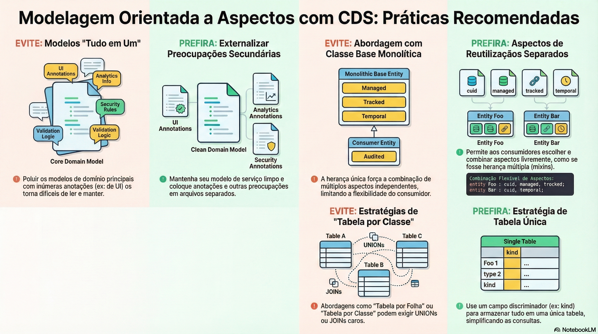

# Aspectos e dados temporais

> **Comece pelos slides: [Aspectos e dados temporais](./01.04_Aspectos_e_dados_temporais.pptx)**
>
> **Referência oficial (Capire):** [Aspect-oriented Modeling](https://cap.cloud.sap/docs/cds/aspects) · [Temporal Data](https://cap.cloud.sap/docs/guides/domain/temporal-data)

Como manter o modelo central limpo com aspectos e guardar passado, presente e futuro de um registro.

## O que você vai aprender

- Mantenha o modelo central **limpo** e coloque UI e segurança em arquivos próprios
- `annotate` acrescenta metadados e `extend` acrescenta elementos, de qualquer lugar
- Aspectos pequenos e independentes vencem a classe base gigante
- Um registro lógico vira várias **fatias de tempo**, fechado-abertas e sem sobreposição
- O par `@cds.valid.from/to` ou o aspecto `temporal` ativa o recurso
- Sem parâmetros, a leitura devolve o que é válido **agora**

## Seções da aula

1. **Separação de interesses:** Um arquivo que mistura tudo fica **difícil de ler**. Mantenha o modelo central enxuto e anote de fora.
2. **Aspectos de reuso:** Na herança simples, tudo acaba em **uma classe base enorme**. Aspectos deixam cada um escolher o que usar.
3. **Adaptar o que é reutilizado:** Um pacote de terceiros quase serve? **Estenda-o** sem alterar uma linha do original.
4. **Dados temporais:** Um modelo **sem tempo** vira temporal com um par de anotações ou um aspecto pronto.
5. **Lendo:** O serviço é um serviço comum. A diferença está nos **parâmetros da requisição** OData.

---

[Voltar ao Módulo 01](../README.md) · Próxima aula: [01.05 Modelagem para performance](../../modulo-01-fundamentos/05-modelagem-para-performance/README.md)
