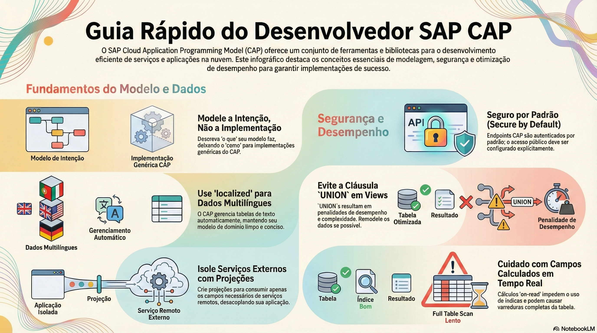

# O que é o CAP e como ele pensa

> **Comece pelos slides: [O que é o CAP e como ele pensa](./01.01_O_que_e_o_CAP.pptx)**
>
> **Referência oficial (Capire):** [Getting Started](https://cap.cloud.sap/docs/get-started/) · [Core Concepts](https://cap.cloud.sap/docs/get-started/concepts) · [Key Features](https://cap.cloud.sap/docs/get-started/features)

Os blocos do framework, o papel dos modelos CDS e a ideia de que quase tudo já vem servido pelo runtime.

## O que você vai aprender

- O CAP reúne **linguagens, bibliotecas e ferramentas** e guia o projeto por boas práticas prontas
- **CDS** captura o domínio; os **runtimes** Node.js e Java usam o modelo para servir requisições
- Serviços são **interfaces** e fachadas para um caso de uso, sem guardar estado
- A implementação de um serviço é a **soma dos seus event handlers**
- Serviço CAP é módulo de software; **microsserviço** é unidade de deploy
- **Calesi** traz serviços de plataforma para o nível CAP, por meio de plugins

## Seções da aula

1. **Os blocos de construção:** O CAP fica **entre o banco de dados e a UI**. A linguagem CDS alimenta tudo o que está ao redor dela.
2. **Serviços e eventos:** Todo elemento ativo é um **serviço**, e tudo o que acontece em runtime é disparado por **eventos**.
3. **O que já vem pronto:** Os runtimes reúnem implementações genéricas para **tarefas recorrentes**, destiladas de aplicações reais da SAP.

## Material complementar

- PDF: [Jornada do Construtor](./01.01_Jornada_do_Construtor.pdf)
- Infográfico: [Jornada do Construtor](./01.01_Jornada_do_Construtor.png)

---

[Voltar ao Módulo 01](../README.md) · Próxima aula: [01.02 Sua primeira aplicação: a Bookshop](../../modulo-01/01.02%20-%20Sua%20primeira%20aplica%C3%A7%C3%A3o%20-%20a%20Bookshop/README.md)
