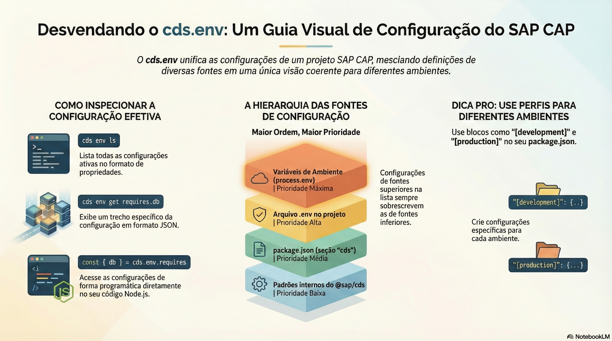

# Configuração e perfis com cds.env

> **Comece pelos slides: [Configuração e perfis com cds.env](./01.03_Configuracao_e_perfis_cds_env.pptx)**
>
> **Referência oficial (Capire):** [Project-Specific Configurations](https://cap.cloud.sap/docs/node.js/cds-env)

De onde vêm as configurações, quem ganha quando elas conflitam e como usar perfis por ambiente.

## O que você vai aprender

- `cds env` mostra a configuração efetiva; `cds.env` dá acesso a ela no código
- Doze fontes são mescladas, e a de **ordem maior** sobrescreve a anterior
- Topologia do projeto fica em `package.json`; o que é pessoal fica em `.cdsrc-private.json` ou `.env`
- `CDS_CONFIG` aceita JSON, arquivo ou diretório, útil para segredos montados
- Blocos `[development]` e `[production]` trocam o banco por perfil, sem mudar código
- `cds.requires` declara os serviços usados, e `kind` encadeia padrões

## Seções da aula

1. **Inspecionando:** Antes de alterar uma configuração, veja o valor que a aplicação **realmente** está usando.
2. **As fontes e a precedência:** As configurações são mescladas **de baixo para cima**. Quanto maior a ordem da fonte, mais força ela tem.
3. **Perfis:** Um único arquivo descreve **vários ambientes**. O perfil ativo decide quais blocos valem.
4. **Serviços e opções da aplicação:** Tudo o que a aplicação consome é declarado em `cds.requires`. A mesma máquina serve para suas próprias opções.

---

[Voltar ao Módulo 01](../README.md) · Próxima aula: [02.01 Entidades, associações e composições](../../modulo-02/02.01%20-%20Entidades,%20associa%C3%A7%C3%B5es%20e%20composi%C3%A7%C3%B5es/README.md)
