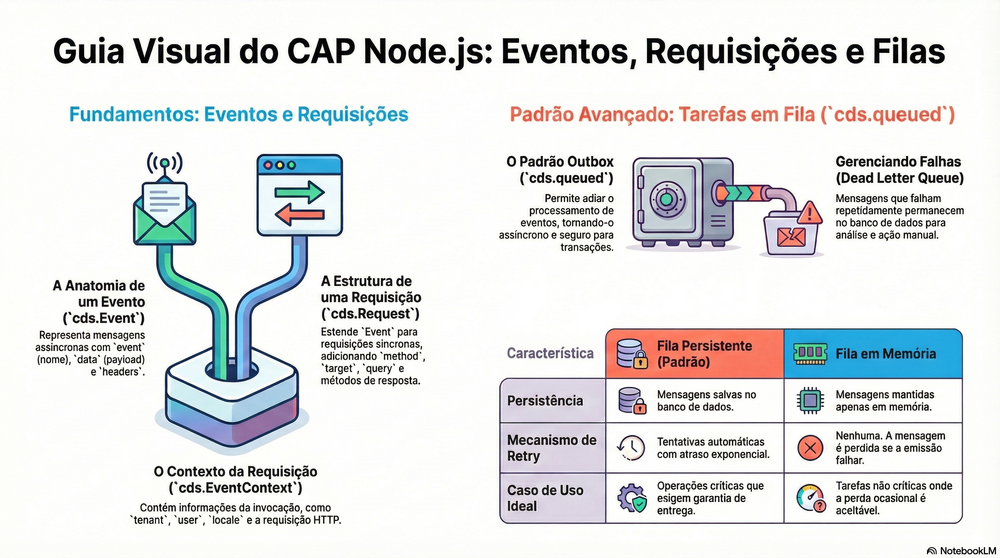

# Handlers, requisições e erros

> **Comece pelos slides: [Handlers, requisições e erros](./02.02_Handlers_requisicoes_e_erros.pptx)**
>
> **Referência oficial (Capire):** [Custom Code](https://cap.cloud.sap/docs/guides/services/custom-code) · [Core Services](https://cap.cloud.sap/docs/node.js/core-services) · [Core Events](https://cap.cloud.sap/docs/node.js/events)

Como escrever lógica de negócio com handlers: as fases before, on e after, o objeto req, os erros e o contexto.

## O que você vai aprender

- A implementação fica em um `.js` ao lado do `.cds`, com **classe** e `init()`
- `before` valida, `on` atende e `after` enriquece a resposta
- Handlers `on` são **interceptadores** em sequência, ligados por `next()`
- `cds.Request` traz `data`, `target`, `params`, `query`, além do usuário e do tenant
- `req.reject` interrompe na hora; `req.error` acumula erros até o fim da fase
- Depois do commit, `succeeded`, `failed` e `done` precisam de `cds.tx()` para usar o banco

## Seções da aula

1. **Onde o código mora:** O CAP localiza a implementação **por convenção**. O serviço é a soma dos handlers que você registra nele.
2. **As três fases:** Cada fase tem um papel: **validar** antes, **atender** durante e **enriquecer** depois.
3. **O objeto req:** `cds.Request` é o principal instrumento do handler: descreve o pedido e oferece as ações de resposta.
4. **Respostas e erros:** Devolva um valor para responder. Use `reject` para parar **já** e `error` para reunir vários problemas.
5. **cds.context e fim da requisição:** O contexto acompanha todo o processamento assíncrono, e você pode reagir ao **fim da transação**.

---

[Voltar ao Módulo 02](../README.md) · Próxima aula: [02.03 Validações, ações e fluxos de status](../../modulo-02-servicos-e-dados/03-validacoes-acoes-e-fluxos-de-status/README.md)
