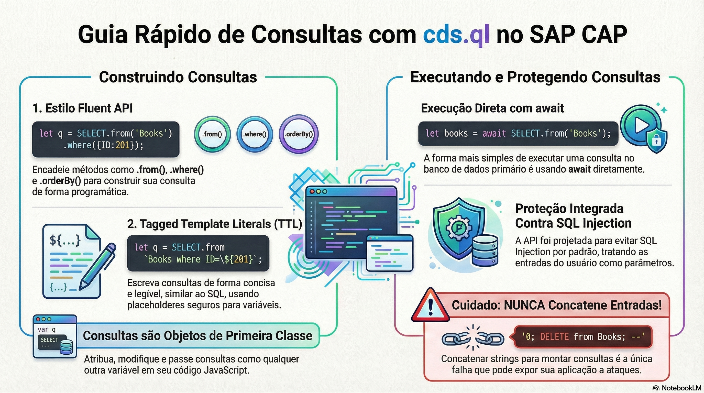

# Consultas com CQL e cds.ql

> **Comece pelos slides: [Consultas com CQL e cds.ql](./02.05_Consultas_com_CQL_e_cds_ql.pptx)**
>
> **Referência oficial (Capire):** [CDS Query Language](https://cap.cloud.sap/docs/cds/cql) · [Querying in JavaScript](https://cap.cloud.sap/docs/node.js/cds-ql)

O que a CQL acrescenta ao SQL e como construir, executar e compor consultas em JavaScript com segurança.

## O que você vai aprender

- A CQL estende o SQL com recursos que aproveitam as **associações** do modelo
- Path expressions viram `LEFT JOIN` nas colunas e *semi-joins* no `from`
- Infix filters restringem um caminho; `exists` testa conjuntos relacionados
- `cds.ql` constrói consultas em CQN, sem amarrar o código ao SQL
- Compor subconsultas evita laços e deixa o trabalho para o banco
- Template strings **sem parênteses** geram parâmetros de bind

## Seções da aula

1. **Projeções:** A projeção depois do `from` permite aninhar campos e moldar **resultados estruturados**.
2. **O seletor inteligente:** Em projeções, o `*` é **mais esperto** que no SQL: nomes explícitos substituem as colunas repetidas.
3. **Path expressions:** Caminhos substituem joins escritos à mão: **navegue** pelo modelo em qualquer cláusula.
4. **Construindo consultas:** Há estilos diferentes para o mesmo resultado, e todos produzem **CQN**.
5. **Executando:** Criar uma consulta **não a executa**. Ela só roda quando é aguardada ou enviada a um serviço.
6. **Evitando SQL injection:** A API já protege por padrão. O risco aparece só quando **você concatena** entrada do usuário.

---

[Voltar ao Módulo 02](../README.md) · Próxima aula: [02.06 Bancos de dados](../../modulo-02-servicos-e-dados/06-bancos-de-dados/README.md)
