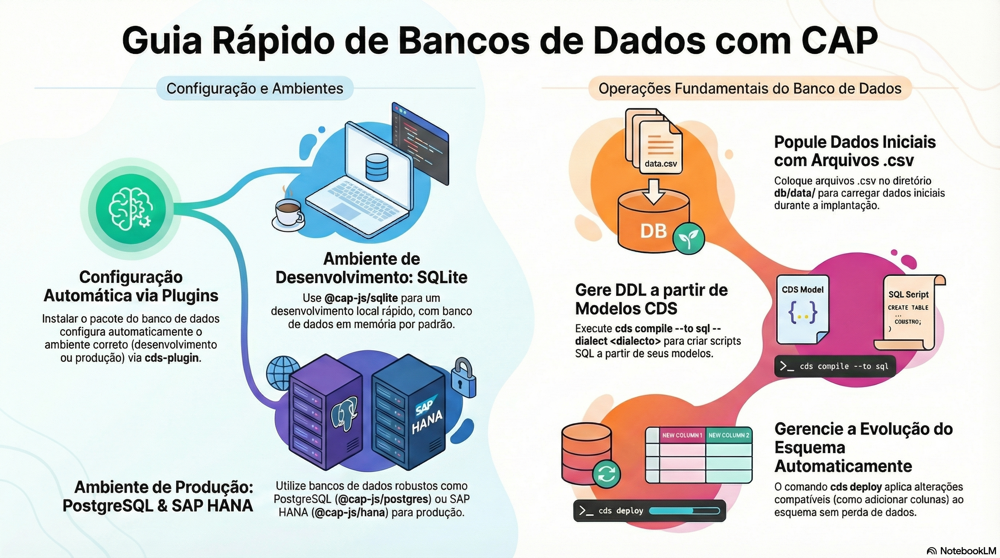

# Bancos de dados

> **Comece pelos slides: [Bancos de dados](./02.06_Bancos_de_dados.pptx)**
>
> **Referência oficial (Capire):** [Databases](https://cap.cloud.sap/docs/guides/databases/) · [Initial Data](https://cap.cloud.sap/docs/guides/databases/initial-data) · [Schema Evolution](https://cap.cloud.sap/docs/guides/databases/schema-evolution) · [Database Services](https://cap.cloud.sap/docs/node.js/databases)

Como o CAP troca de banco sem mudar o código: SQLite, PostgreSQL, SAP HANA, dados iniciais e evolução de esquema.

## O que você vai aprender

- O CAP compila, implanta e serve dados com **interface agnóstica** de banco
- SQLite acelera o desenvolvimento, e SAP HANA é o banco de produção
- Prefira `cds add` para adicionar um banco, pois ele cuida do deploy
- `db/data` vai sempre; `test/data` só em desenvolvimento
- Em produção, gere migrações com `cds deploy --delta-from`, sem drop-create
- Serviços de banco têm pool ajustável e `UPSERT` para replicação

## Seções da aula

1. **Escolhendo o banco:** SQLite acelera o ciclo local, e SAP HANA é o destino de produção, **sem alterar** modelos nem implementações.
2. **Dados iniciais:** Separe o que vai para **produção** do que serve apenas para **teste**.
3. **Evolução de esquema:** No desenvolvimento, recriar tudo é o normal. Em **produção**, nenhum dado pode ser perdido.
4. **cds.DatabaseService:** Bancos também são **serviços CAP**: têm interface agnóstica e aceitam handlers como qualquer outro.

---

[Voltar ao Módulo 02](../README.md) · Próxima aula: [02.07 Localização: dados e textos](../../modulo-02-servicos-e-dados/07-localizacao/README.md)
