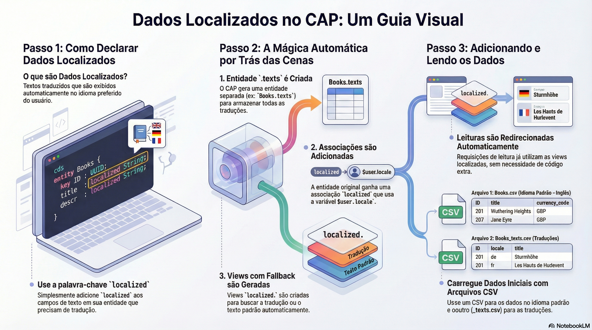

# Localização: dados e textos

> **Comece pelos slides: [Localização: dados e textos](./02.07_Localizacao_dados_e_textos.pptx)**
>
> **Referência oficial (Capire):** [Localized Data](https://cap.cloud.sap/docs/guides/uis/localized-data) · [Localization, i18n](https://cap.cloud.sap/docs/guides/uis/i18n) · [cds.i18n](https://cap.cloud.sap/docs/node.js/cds-i18n)

Como traduzir dados com o modificador localized e textos estáticos com pacotes i18n e a API cds.i18n.

## O que você vai aprender

- O modificador `localized` marca os elementos que têm tradução
- O compilador gera `.texts`, as associações `texts` e `localized`, e views com fallback
- `$user.locale` decide o idioma; em SQLite há views por idioma
- Troque literais por chaves `{i18n>...}` e guarde os textos em `_i18n/`
- A pilha de textos é: idioma pedido, idioma padrão e reserva padrão
- `req.reject` aceita chaves de `messages.properties`, com argumentos

## Seções da aula

1. **Nos bastidores:** O compilador **desdobra** o modificador `localized` em três partes, sem esforço de sua parte.
2. **Lendo:** Três leitores, três formas de pedir os textos: **agnóstica, por usuário e para tradução**.
3. **Externalizando:** Troque literais por **chaves** e guarde os textos em arquivos separados por idioma.
4. **Mensagens de runtime:** Use chaves nas mensagens de erro, e o runtime faz a tradução para o idioma do usuário.

---

[Voltar ao Módulo 02](../README.md) · Próxima aula: [02.08 Rascunhos (draft)](../../modulo-02-servicos-e-dados/08-rascunhos/README.md)
