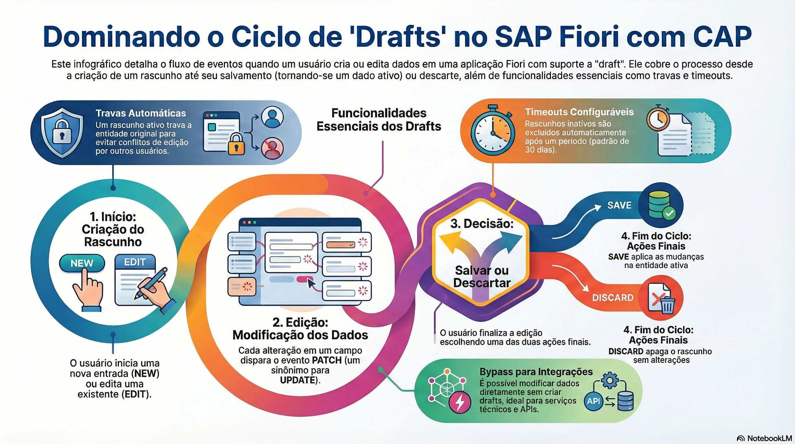

# Rascunhos (draft)

> **Comece pelos slides: [Rascunhos (draft)](./02.08_Rascunhos_draft.pptx)**
>
> **Referência oficial (Capire):** [Serving Fiori UIs: Draft](https://cap.cloud.sap/docs/guides/uis/fiori) · [Fiori Support in Node.js](https://cap.cloud.sap/docs/node.js/fiori)

Como permitir edição segura, com progresso salvo no servidor, usando uma anotação e os eventos de rascunho.

## O que você vai aprender

- `@odata.draft.enabled` ativa o rascunho e gera a entidade `.drafts`
- Rascunhos ficam **isolados** dos dados ativos até o `SAVE`
- O fluxo é `NEW` ou `EDIT`, vários `PATCH`, e por fim `SAVE` ou `DISCARD`
- Handlers usam `Foo.drafts`, exceto `EDIT`, registrado na entidade ativa
- Um rascunho bloqueia o registro ativo até salvar, descartar ou expirar
- Desde o cds 10, clientes acessam dados ativos direto com `IsActiveEntity=true`, ou sem o parâmetro com `draft_new_action`

## Seções da aula

1. **Ativando:** Basta anotar a entidade. O CAP cuida do resto, inclusive da coreografia exigida pelo SAP Fiori.
2. **A coreografia:** O CAP serve automaticamente o fluxo: **criar ou editar**, ajustar com `PATCH` e, por fim, salvar ou descartar.
3. **Código nos rascunhos:** Eventos próprios permitem preparar, validar e reagir em cada etapa do ciclo.
4. **Regras de convivência:** Bloqueios e limpeza automática evitam conflitos e **rascunhos esquecidos**.

---

[Voltar ao Módulo 02](../README.md) · Próxima aula: [02.09 Serviços remotos e conexões](../../modulo-02-servicos-e-dados/09-servicos-remotos-e-conexoes/README.md)
