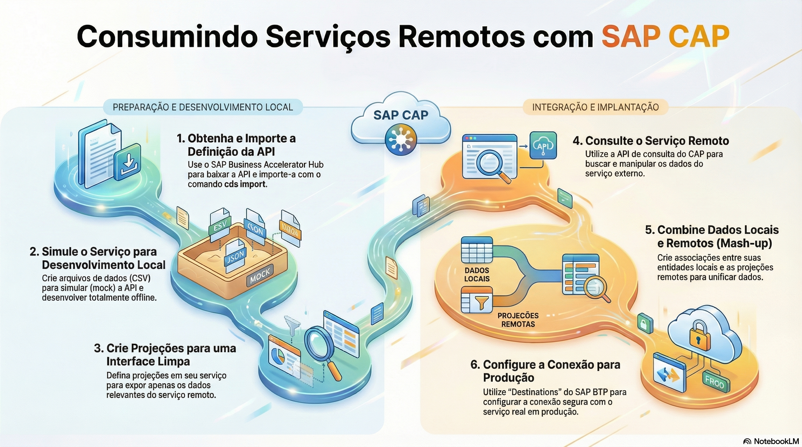

# Serviços remotos e conexões

> **Comece pelos slides: [Serviços remotos e conexões](./02.09_Servicos_remotos_e_conexoes.pptx)**
>
> **Referência oficial (Capire):** [Consuming Services](https://cap.cloud.sap/docs/guides/services/consuming-services) · [Remote Services](https://cap.cloud.sap/docs/node.js/remote-services) · [cds.connect](https://cap.cloud.sap/docs/node.js/cds-connect) · [cds bind](https://cap.cloud.sap/docs/tools/cds-bind)

Como trazer APIs externas para o modelo, desenvolver com mocks e transformar nomes de serviço em conexões reais.

## O que você vai aprender

- `cds import` transforma EDMX, OpenAPI e AsyncAPI em modelo CDS
- `cds watch` simula o serviço, com dados em `srv/external/data`
- Serviços remotos usam as **mesmas APIs** de consulta do CAP
- Projeções próprias isolam seu código e mapeiam campos automaticamente
- `cds.connect.to()` devolve um cliente para serviços locais, remotos e bancos
- O binding preenche `credentials`: **segredos nunca** entram nos arquivos do projeto

## Seções da aula

1. **Importando a API:** `cds import` transforma uma especificação externa em **modelo CDS**, com a declaração do serviço pronta.
2. **Desenvolvendo com mocks:** Com o modelo importado, o `cds watch` **simula** o serviço remoto. Não é preciso acesso ao sistema real.
3. **Consultando:** Serviços remotos usam a **mesma API de consulta**. Projeções próprias isolam seu código do formato externo.
4. **Integrando:** Associações entre local e remoto precisam de **tratamento manual**, porque as fontes de dados são diferentes.
5. **Conectando:** Como o nome de um serviço vira uma conexão real, com credenciais em cada ambiente.

---

[Voltar ao Módulo 02](../README.md) · Próxima aula: [02.10 Eventos e mensageria](../../modulo-02-servicos-e-dados/10-eventos-e-mensageria/README.md)
