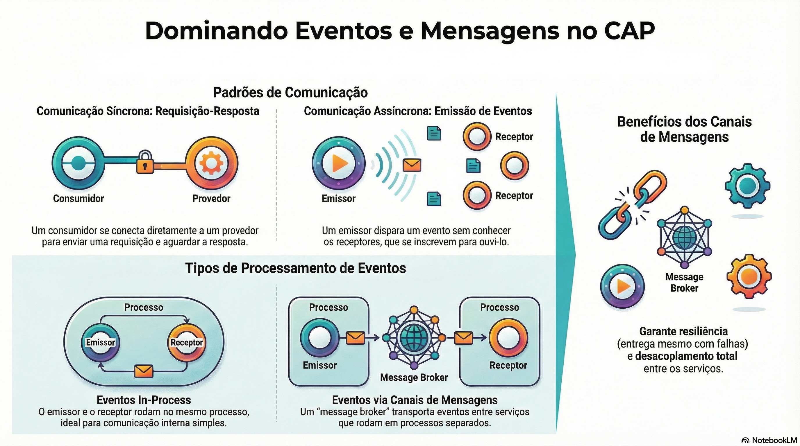

# Eventos e mensageria

> **Comece pelos slides: [Eventos e mensageria](./02.10_Eventos_e_mensageria.pptx)**
>
> **Referência oficial (Capire):** [Events & Messaging](https://cap.cloud.sap/docs/guides/events/) · [Messaging](https://cap.cloud.sap/docs/node.js/messaging) · [Event Queues](https://cap.cloud.sap/docs/node.js/event-queues)

Como declarar, emitir e receber eventos, levar mensagens entre processos e garantir a entrega com filas e agendamento.

## O que você vai aprender

- Todos os serviços **emitem eventos**, e os mecanismos são os mesmos das requisições
- Emissores usam `srv.emit`, e receptores se conectam e usam `srv.on`
- Mudar de canal é configuração: `file-based-messaging` no desenvolvimento, broker em produção
- Com mensageria, o que é emitido durante uma queda **chega depois**
- `cds.queued` liga o envio à transação, com novas tentativas e dead letter
- `srv.schedule` agenda tarefas únicas com `.after`, `.every` e cron, e `.as` separa identidades do mesmo evento

## Seções da aula

1. **Declarar, emitir e receber:** Serviços têm API **síncrona e assíncrona**. Eventos são declarados no modelo, com foco no domínio.
2. **Entre processos:** Com serviços em processos separados, um **canal de mensagens** repassa os eventos. Só muda a configuração.
3. **Filas de eventos:** Filas persistentes ligam a mensagem à **transação**: só é enviada se a gravação der certo.

---

[Voltar ao Módulo 02](../README.md) · Próxima aula: [03.01 SAP Fiori Elements e Fiori tools](../../modulo-03-interfaces/01-sap-fiori-elements/README.md)
