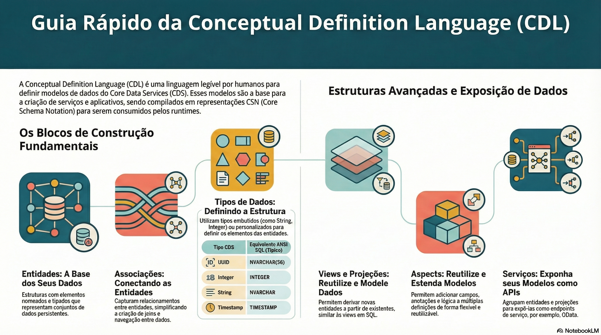

# Entidades, associações e composições

> **Comece pelos slides: [Entidades, associações e composições](./02.01_Entidades_associacoes_e_composicoes.pptx)**
>
> **Referência oficial (Capire):** [Domain Modeling](https://cap.cloud.sap/docs/guides/domain/) · [CDL Reference](https://cap.cloud.sap/docs/cds/cdl)

Como escrever um modelo que captura a intenção: chaves, relacionamentos, documentos e boas práticas.

## O que você vai aprender

- CDS captura **o quê**, não **como**; as implementações genéricas cuidam do resto
- Entidades no plural, tipos no singular e elementos concisos em minúsculas
- Prefira chaves **simples, canônicas e UUID**, e nunca interprete um UUID
- Use associações **gerenciadas** para `to one`; para muitos exige `on` com `$self`
- Composições modelam documentos: deep insert, delete em cascata e exposição automática
- Prefira **modelos planos** e crie tipos próprios só quando houver reuso real

## Seções da aula

1. **Entidades e chaves:** Entidades representam os **dados do domínio** e viram tabelas no modelo de persistência.
2. **Associações:** Associações capturam **relacionamentos** entre entidades e substituem o que, em SQL, seriam chaves estrangeiras e joins escritos à mão.
3. **Composições:** Composições representam relações de **contido em**: os itens só existem dentro do documento que os contém.
4. **Boas práticas:** Modelos **planos** e tipos próprios usados com parcimônia deixam o domínio fácil de consumir.

## Material complementar

- PDF: [CDL Modelagem Inteligente](./02.01_CDL_Modelagem_Inteligente.pdf)
- PDF: [Modelagem com Intencao](./02.01_Modelagem_com_Intencao.pdf)
- PDF: [SAP CDS Projeto e Realidade](./02.01_SAP_CDS_Projeto_e_Realidade.pdf)
- Infográfico: [CDL Modelagem Inteligente](./02.01_CDL_Modelagem_Inteligente.png)
- Infográfico: [Modelagem com Intencao](./02.01_Modelagem_com_Intencao.png)
- Infográfico: [SAP CDS Projeto e Realidade](./02.01_SAP_CDS_Projeto_e_Realidade.png)

---

[Voltar ao Módulo 02](../README.md) · Próxima aula: [02.02 Tipos, @sap/cds/common e anotações](../../modulo-02/02.02%20-%20Tipos,%20@sap-cds-common%20e%20anota%C3%A7%C3%B5es/README.md)
