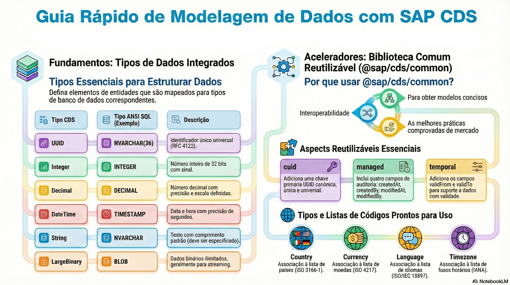

# Tipos, @sap/cds/common e anotações

> **Comece pelos slides: [Tipos, @sap/cds/common e anotações](./02.02_Tipos_common_e_anotacoes.pptx)**
>
> **Referência oficial (Capire):** [Core / Built-in Types](https://cap.cloud.sap/docs/cds/types) · [Common Reuse Models](https://cap.cloud.sap/docs/cds/common) · [Common Annotations](https://cap.cloud.sap/docs/cds/annotations)

Os tipos nativos do CDS, os modelos prontos de @sap/cds/common e as anotações mais usadas.

## O que você vai aprender

- O CDS tem **poucos tipos nativos**, cada um com mapeamento padrão para SQL
- Em produção, defina o tamanho de `String`: o padrão varia conforme o banco
- Crie tipos próprios só quando houver **reuso**; sem isso, o modelo fica mais difícil de ler
- `cuid` e `managed` trazem chave UUID e auditoria, preenchidas pelo runtime
- `Country`, `Currency` e `Language` são **associações** para code lists
- Anotações agrupam-se por família: validação, acesso, serviços, persistência e OData

## Seções da aula

1. **Tipos nativos:** O CDS tem poucos tipos, e cada um tem um **mapeamento** padrão para ANSI SQL.
2. **@sap/cds/common:** Um modelo enxuto, sem runtime especial, com **práticas recolhidas de aplicações reais**.
3. **Anotações comuns:** As anotações ligam **comportamento** ao modelo, sem misturar código de implementação.

---

[Voltar ao Módulo 02](../README.md) · Próxima aula: [02.03 Aspectos e separação de responsabilidades](../../modulo-02/02.03%20-%20Aspectos%20e%20separa%C3%A7%C3%A3o%20de%20responsabilidades/README.md)
