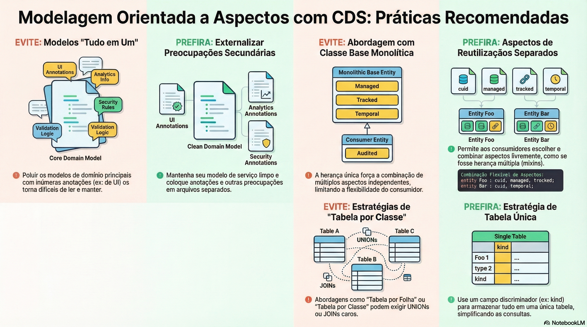

# Aspectos e separação de responsabilidades

> **Comece pelos slides: [Aspectos e separação de responsabilidades](./02.03_Aspectos_e_separacao_de_responsabilidades.pptx)**
>
> **Referência oficial (Capire):** [Aspect-oriented Modeling](https://cap.cloud.sap/docs/cds/aspects) · [Domain Modeling](https://cap.cloud.sap/docs/guides/domain/)

Como manter o modelo central limpo e compor comportamentos sem hierarquias de herança.

## O que você vai aprender

- Mantenha o modelo central **limpo** e coloque UI e segurança em arquivos próprios
- `annotate` acrescenta metadados e `extend` acrescenta elementos, de qualquer lugar
- O consumidor sempre enxerga o **modelo efetivo**; a separação é transparente
- Aspectos pequenos e independentes vencem a classe base gigante
- A sintaxe `:` parece herança, mas são **mixins**, sem o problema do diamante
- Definições de terceiros aceitam novos campos, relações e aspectos sem alterar o original

## Seções da aula

1. **Separação de interesses:** Um arquivo que mistura tudo fica **difícil de ler**. Mantenha o modelo central enxuto e anote de fora.
2. **Aspectos de reuso:** Na herança simples, tudo acaba em **uma classe base enorme**. Aspectos deixam cada um escolher o que usar.
3. **Adaptar o que é reutilizado:** Um pacote de terceiros quase serve? **Estenda-o** sem alterar uma linha do original.

## Material complementar

- PDF: [Modelagem de Aspectos](./02.03_Modelagem_de_Aspectos.pdf)
- Infográfico: [Modelagem de Aspectos](./02.03_Modelagem_de_Aspectos.png)

---

[Voltar ao Módulo 02](../README.md) · Próxima aula: [02.04 Dados temporais](../../modulo-02/02.04%20-%20Dados%20temporais/README.md)
