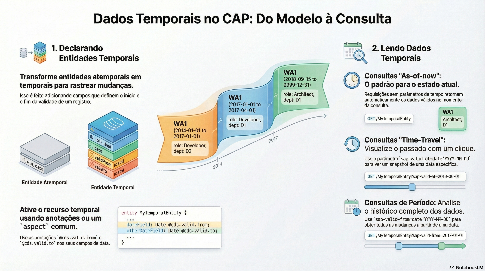

# Dados temporais

> **Comece pelos slides: [Dados temporais](./02.04_Dados_temporais.pptx)**
>
> **Referência oficial (Capire):** [Temporal Data](https://cap.cloud.sap/docs/guides/domain/temporal-data)

Como guardar o passado, o presente e o futuro de um registro com poucas palavras no modelo.

## O que você vai aprender

- Um registro lógico vira várias **fatias de tempo**, fechado-abertas e sem sobreposição
- O par `@cds.valid.from/to` ou o aspecto `temporal` ativa o recurso
- Separe a parte temporal em uma composição quando só alguns campos mudarem
- Sem parâmetros, a leitura devolve o que é válido **agora**
- `sap-valid-at` e `sap-valid-from` fazem viagem no tempo e leem períodos, mas não em SQLite
- A escrita temporal exige handlers próprios, e a chave SQL inclui `validFrom`

## Seções da aula

1. **Declarando:** Um modelo **sem tempo** vira temporal com um par de anotações ou um aspecto pronto.
2. **Lendo:** O serviço é um serviço comum. A diferença está nos **parâmetros da requisição** OData.
3. **Chaves das fatias:** O **modelo** enxerga um registro. A **tabela** guarda várias linhas para ele.

---

[Voltar ao Módulo 02](../README.md) · Próxima aula: [02.05 Modelagem para performance](../../modulo-02/02.05%20-%20Modelagem%20para%20performance/README.md)
