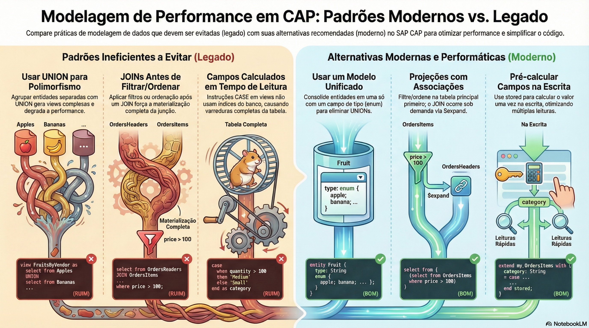

# Modelagem para performance

> **Comece pelos slides: [Modelagem para performance](./02.05_Modelagem_para_performance.pptx)**
>
> **Referência oficial (Capire):** [Performance Modeling](https://cap.cloud.sap/docs/guides/databases/performance)

As decisões de modelo que mais pesam na performance: UNION, JOIN, campos calculados e heranças de sistemas legados.

## O que você vai aprender

- Em modelos novos, **UNION não deveria ser necessário**: resuma entidades parecidas em uma só
- Projeções com associações trocam o join fixo por join **sob demanda**
- Ordene e filtre **antes** de juntar dados, usando subconsultas e associações
- Campos calculados não usam índices: prefira UI, depois `stored`, depois *on read*
- Use composição para ciclo de vida compartilhado; associação para relações que mudam
- Documentos enormes com draft pedem associações, e padrões legados pedem remodelagem

## Seções da aula

1. **Polimorfismo sem UNION:** Em modelos novos, **UNION não deveria ser necessário**. Ele costuma ser sintoma de entidades que deveriam ser uma só.
2. **Associações no lugar de JOIN:** Um **JOIN** em uma view roda sempre. Uma **associação** só vira join quando o consumidor pede.
3. **Campos calculados:** Operações sobre campos calculados **não usam índices**: geram leitura completa da tabela.
4. **Relações e legado:** Decidir entre composição e associação também afeta performance, e o **legado** não precisa ser copiado.

---

[Voltar ao Módulo 02](../README.md) · Próxima aula: [03.01 Definindo e servindo serviços](../../modulo-03/03.01%20-%20Definindo%20e%20servindo%20servi%C3%A7os/README.md)
