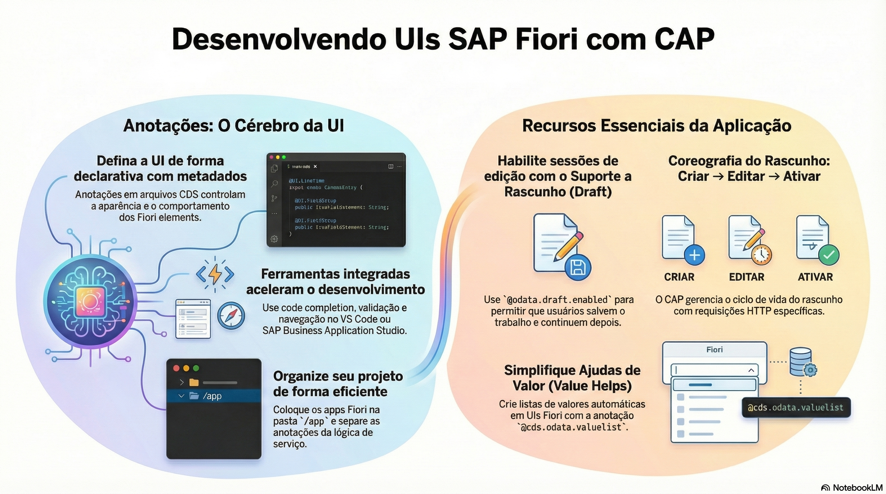

# SAP Fiori Elements e Fiori tools

> **Comece pelos slides: [SAP Fiori Elements e Fiori tools](./03.01_SAP_Fiori_Elements_e_Fiori_tools.pptx)**
>
> **Referência oficial (Capire):** [Serving Fiori UIs](https://cap.cloud.sap/docs/guides/uis/fiori) · [Curso SAP: Fiori Elements com CAP OData V4](https://learning.sap.com/courses/developing-an-sap-fiori-elements-app-based-on-a-cap-odata-v4-service) · [Feature Showcase](https://github.com/SAP-samples/fiori-elements-feature-showcase)

O que o SAP Fiori Elements entrega, quais templates existem, como as Fiori tools ajudam e as anotações que formam a primeira tela.

## O que você vai aprender

- Fiori Elements constrói a interface a partir de **metadados anotados**
- Escolha o template pelo trabalho do usuário: List Report e Object Page são a dupla mais comum
- SAP Fiori tools geram o app e configuram páginas com Page Map e Guided Development
- O `manifest.json` liga cada página ao serviço, com `contextPath` e rotas
- `SelectionFields` e `LineItem` definem o List Report
- `HeaderInfo`, `Facets` e `FieldGroup` definem a Object Page

## Seções da aula

1. **Templates e ferramentas:** Antes de anotar, escolha o tipo de página e conheça as ferramentas que geram e configuram o app.
2. **Começando:** O preview já mostra uma lista sem nenhum app criado. Para uma aplicação real, use a pasta `app/`.
3. **As páginas:** Um **List Report** mostra a coleção, e uma **Object Page** mostra um registro. Ambos vêm do vocabulário `UI`.
4. **Anotações comuns:** Prefira anotações **agnósticas de protocolo** em modelos e serviços. O CAP as traduz para OData.
5. **Ajudas de valor e árvores:** Atalhos do CAP adicionam listas de valores e visualizações hierárquicas com **uma anotação**.

---

[Voltar ao Módulo 03](../README.md) · Próxima aula: [03.02 List Report: filtros, ações e visões](../../modulo-03-interfaces/02-list-report/README.md)
