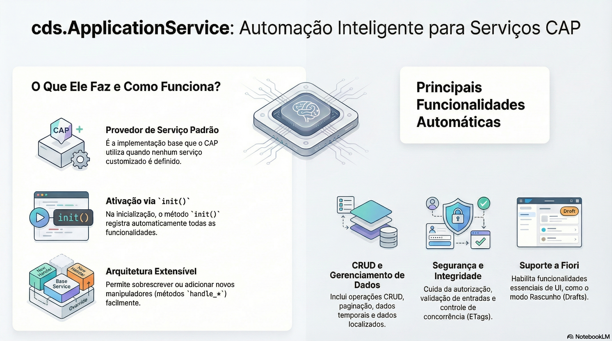

# Definindo e servindo serviços

> **Comece pelos slides: [Definindo e servindo serviços](./03.01_Definindo_e_servindo_servicos.pptx)**
>
> **Referência oficial (Capire):** [Providing Services](https://cap.cloud.sap/docs/guides/services/providing-services) · [Served Out of the Box](https://cap.cloud.sap/docs/guides/services/served-ootb) · [cds.ApplicationService](https://cap.cloud.sap/docs/node.js/app-services)

Como desenhar serviços por caso de uso e o que o provedor genérico faz sem nenhuma linha de código.

## O que você vai aprender

- Uma definição de serviço basta para um **servidor completo**, sem código
- Serviços são **fachadas**: projeções moldam e escondem dados para cada uso
- Crie **um serviço por caso de uso**; evite expor tudo em 1:1
- Composições são criadas em profundidade; associações só recebem a chave
- Busca, paginação, chaves UUID e ETags vêm prontas e são ajustáveis
- `cds.ApplicationService` registra os handlers genéricos no `init()`

## Seções da aula

1. **Definindo serviços:** Serviços expõem **projeções** sobre o domínio, moldadas para quem vai consumir.
2. **Servido pronto:** Os handlers genéricos atendem **a maioria das requisições**. O código próprio fica restrito à lógica específica do seu negócio.
3. **cds.ApplicationService:** O provedor padrão é uma classe comum. Entender seu `init()` explica de onde vem o comportamento pronto.

## Material complementar

- Infográfico: [ApplicationService Mastery](./03.01_ApplicationService_Mastery.png)
- Infográfico: [Jornada do Desenvolvedor](./03.01_Jornada_do_Desenvolvedor.png)

---

[Voltar ao Módulo 03](../README.md) · Próxima aula: [03.02 Event handlers: before, on e after](../../modulo-03/03.02%20-%20Event%20handlers%20-%20before,%20on%20e%20after/README.md)
