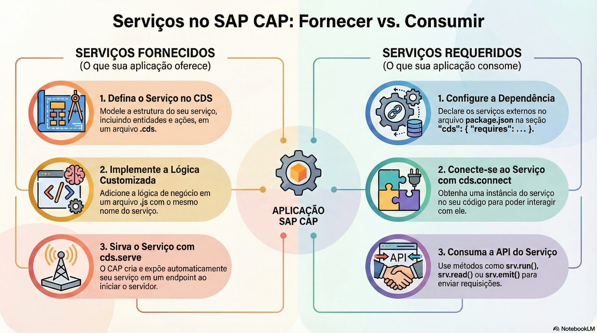

# Event handlers: before, on e after

> **Comece pelos slides: [Event handlers: before, on e after](./03.02_Event_handlers_before_on_after.pptx)**
>
> **Referência oficial (Capire):** [Custom Code](https://cap.cloud.sap/docs/guides/services/custom-code) · [Core Services](https://cap.cloud.sap/docs/node.js/core-services)

Como escrever lógica de negócio com handlers, e o que muda entre as fases before, on e after.

## O que você vai aprender

- Prefira técnicas **declarativas**; escreva handlers só para o que elas não cobrem
- A implementação fica em um `.js` ao lado do `.cds`, com **classe** e `init()`
- `before` valida, `on` atende e `after` enriquece a resposta
- Handlers `on` são **interceptadores** em sequência, ligados por `next()`
- Handlers `before` e `after` são **ouvintes** e rodam em paralelo
- Eventos são ouvidos de fora, e todos os handlers rodam ao mesmo tempo

## Seções da aula

1. **Onde o código mora:** O CAP localiza a implementação **por convenção**. O serviço é a soma dos handlers que você registra nele.
2. **As três fases:** Cada fase tem um papel: **validar** antes, **atender** durante e **enriquecer** depois.
3. **Eventos e erros:** Além de requisições, serviços emitem **eventos assíncronos** e têm um ponto central para tratar erros.

## Material complementar

- PDF: [Services Dominando a Dualidade](./03.02_Services_Dominando_a_Dualidade.pdf)
- Infográfico: [Services Dominando a Dualidade](./03.02_Services_Dominando_a_Dualidade.png)

---

[Voltar ao Módulo 03](../README.md) · Próxima aula: [03.03 Requisições, erros e cds.context](../../modulo-03/03.03%20-%20Requisi%C3%A7%C3%B5es,%20erros%20e%20cds.context/README.md)
