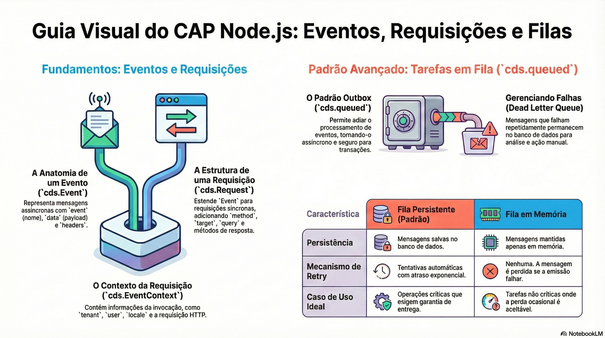

# Requisições, erros e cds.context

> **Comece pelos slides: [Requisições, erros e cds.context](./03.03_Requisicoes_erros_e_contexto.pptx)**
>
> **Referência oficial (Capire):** [Core Events](https://cap.cloud.sap/docs/node.js/events)

O objeto req em detalhe, as formas de recusar uma requisição e como o contexto acompanha o processamento.

## O que você vai aprender

- `cds.Request` traz `data`, `target`, `params`, `query`, além do usuário e do tenant
- `req.subject` aponta para a linha alvo e funciona direto com `cds.ql`
- `req.reject` interrompe na hora; `req.error` acumula erros até o fim da fase
- `code` é chave de i18n, e `target` liga o erro ao campo na UI
- Em produção, as mensagens de erros `5xx` são **sanitizadas** automaticamente
- Depois do commit, `succeeded`, `failed` e `done` precisam de `cds.tx()` para usar o banco

## Seções da aula

1. **O objeto req:** `cds.Request` é o principal instrumento do handler: descreve o pedido e oferece as ações de resposta.
2. **Respostas e erros:** Devolva um valor para responder. Use `reject` para parar **já** e `error` para reunir vários problemas.
3. **cds.context e fim da requisição:** O contexto acompanha todo o processamento assíncrono, e você pode reagir ao **fim da transação**.

## Material complementar

- PDF: [Fluxo Requisicoes Sync Async](./03.03_Fluxo_Requisicoes_Sync_Async.pdf)
- Infográfico: [Fluxo Requisicoes Sync Async](./03.03_Fluxo_Requisicoes_Sync_Async.png)

---

[Voltar ao Módulo 03](../README.md) · Próxima aula: [03.04 Validações, ações e fluxos de status](../../modulo-03/03.04%20-%20Valida%C3%A7%C3%B5es,%20a%C3%A7%C3%B5es%20e%20fluxos%20de%20status/README.md)
