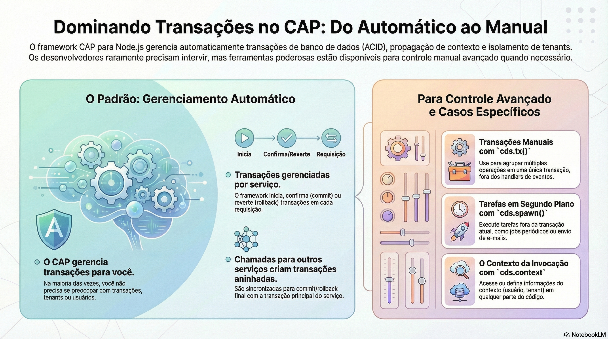

# Transações com cds.tx

> **Comece pelos slides: [Transações com cds.tx](./03.05_Transacoes_com_cds_tx.pptx)**
>
> **Referência oficial (Capire):** [Transaction Management](https://cap.cloud.sap/docs/node.js/cds-tx)

Como o runtime cuida das transações sozinho e quando você precisa assumir o controle.

## O que você vai aprender

- Em handlers, o runtime gerencia transações, propagação de usuário e isolamento de tenants
- Chamadas a outros serviços viram transações **aninhadas**, sincronizadas com a raiz
- O CAP **não** tem transações distribuídas: as aninhadas só são sincronizadas
- `cds.tx(fn)` faz commit ou rollback sozinho e é a forma preferida
- Uma nova transação herda `cds.context`, e você pode sobrescrever usuário e tenant
- `cds.spawn` roda tarefas em segundo plano, com contexto e transação próprios

## Seções da aula

1. **Transações automáticas:** Ao processar um pedido, o serviço cuida de **abrir, confirmar ou desfazer** a transação.
2. **Transações manuais:** Fora de um handler, por exemplo em scripts, use `cds.tx()` para garantir que **várias consultas** rodem juntas.
3. **Contexto:** Uma transação nova demarca outro limite ACID, mas **herda** o contexto atual, salvo o que você sobrescrever.
4. **Tarefas em segundo plano:** Algumas tarefas devem rodar **fora** da requisição, com outro usuário ou repetidamente.

## Material complementar

- PDF: [Transacoes Autopilot Manual](./03.05_Transacoes_Autopilot_Manual.pdf)
- Infográfico: [Transacoes Autopilot Manual](./03.05_Transacoes_Autopilot_Manual.png)

---

[Voltar ao Módulo 03](../README.md) · Próxima aula: [03.06 TypeScript no CAP](../../modulo-03/03.06%20-%20TypeScript%20no%20CAP/README.md)
