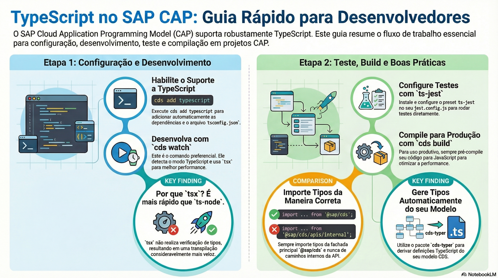

# TypeScript no CAP

> **Comece pelos slides: [TypeScript no CAP](./03.06_TypeScript_no_CAP.pptx)**
>
> **Referência oficial (Capire):** [Using TypeScript](https://cap.cloud.sap/docs/node.js/typescript) · [CDS Typer](https://cap.cloud.sap/docs/tools/cds-typer)

Como ligar TypeScript no projeto, rodar, testar, compilar e gerar tipos a partir do modelo CDS.

## O que você vai aprender

- `cds add typescript` cria o `tsconfig.json` e adiciona o `cds-typer`
- `cds watch` detecta o `tsconfig.json` e roda com `tsx`, mais rápido que `ts-node`
- Em produção, **sempre** pré-compile: `tsx` e `cds-tsx` são só para desenvolvimento
- Com `ts-jest`, a variável `CDS_TYPESCRIPT` avisa o CAP para procurar arquivos `.ts`
- Importe tipos sempre de `@sap/cds`, nunca de caminhos internos
- `cds-typer` gera tipos do modelo, disponíveis em `#cds-models`

## Seções da aula

1. **Habilitando:** Um único comando prepara o projeto, inclusive com a geração de tipos.
2. **Desenvolvendo:** Durante o desenvolvimento, nada muda: `cds watch` percebe que o projeto é TypeScript.
3. **Testando e compilando:** Testes rodam **sem pré-compilar**. O build gera o JavaScript que vai para a nuvem.
4. **Tipos:** Há dois grupos de tipos: os da **API do CAP** e os gerados do **seu modelo**.

## Material complementar

- PDF: [TypeScript Guia Definitivo](./03.06_TypeScript_Guia_Definitivo.pdf)
- Infográfico: [TypeScript Guia Definitivo](./03.06_TypeScript_Guia_Definitivo.png)

---

[Voltar ao Módulo 03](../README.md) · Próxima aula: [04.01 CQL: a linguagem de consulta do CDS](../../modulo-04/04.01%20-%20CQL%20-%20a%20linguagem%20de%20consulta%20do%20CDS/README.md)
