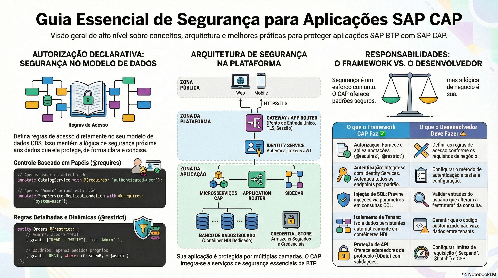

# Autenticação e autorização

> **Comece pelos slides: [Autenticação e autorização](./04.01_Autenticacao_e_autorizacao.pptx)**
>
> **Referência oficial (Capire):** [Authentication](https://cap.cloud.sap/docs/guides/security/authentication) · [CAP Users](https://cap.cloud.sap/docs/guides/security/cap-users) · [Authorization](https://cap.cloud.sap/docs/guides/security/authorization) · [Authentication in Node.js](https://cap.cloud.sap/docs/node.js/authentication)

Quem chama a aplicação e o que cada papel pode fazer: usuário CAP, IAS, XSUAA, @requires e @restrict.

## O que você vai aprender

- `req.user` traz `id`, `attr` e `is()`, independentemente da estratégia
- `mocked` serve ao desenvolvimento e **nunca** deve ir para produção
- IAS é a primeira escolha; XSUAA atende aplicações existentes
- Sem modelagem, serviços CDS **não têm** controle de acesso
- `@requires` exige papéis; `@restrict` define privilégios com `grant`, `to` e `where`
- `where` filtra por instância, usando `$user` e `$user.<atributo>`

## Seções da aula

1. **O usuário CAP:** Após a autenticação, o usuário fica disponível em `req.user`, **desacoplado** da estratégia utilizada.
2. **Desenvolvimento:** Sem serviço de identidade, usuários simulados permitem **testar papéis** na sua máquina.
3. **Produção:** Na nuvem, a estratégia padrão é `jwt`, e **todos os endpoints** exigem autenticação.
4. **Controle estático:** Restringe operações para **todos os usuários**, sem depender de papéis.
5. **Controle por papel:** Restrições respondem a **o quê** (evento), **quem** (papel) e **qual** (filtro).
6. **Controle por instância:** A condição `where` age como um **filtro**: o usuário só alcança os registros que atendem a ela.

---

[Voltar ao Módulo 04](../README.md) · Próxima aula: [04.02 Privacidade e audit log](../../modulo-04-seguranca-e-operacao/02-privacidade-e-audit-log/README.md)
