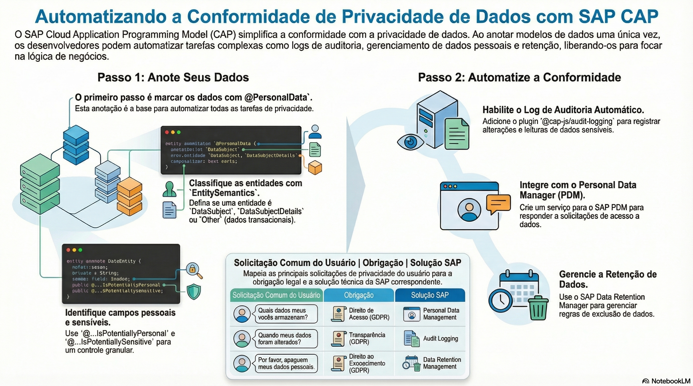

# Privacidade e audit log

> **Comece pelos slides: [Privacidade e audit log](./04.02_Privacidade_e_audit_log.pptx)**
>
> **Referência oficial (Capire):** [Data Privacy](https://cap.cloud.sap/docs/guides/security/data-privacy) · [Annotations](https://cap.cloud.sap/docs/guides/security/dpp-annotations) · [Audit Logging](https://cap.cloud.sap/docs/guides/security/dpp-audit-logging)

Como anotar dados pessoais uma vez e obter audit log, gestão de dados pessoais e apoio à conformidade.

## O que você vai aprender

- Anotar `@PersonalData` é a primeira, e muitas vezes a única, tarefa do desenvolvedor
- Entidades são `DataSubject`, `DataSubjectDetails` ou `Other`
- `DataSubjectID` identifica o titular em toda entidade anotada
- O plugin `@cap-js/audit-logging` audita alterações e leituras automaticamente
- A fila transacional garante a entrega e evita logs de operações desfeitas
- Um serviço dedicado integra a aplicação ao SAP Personal Data Manager

## Seções da aula

1. **Anotando dados pessoais:** A primeira, e muitas vezes a **única**, tarefa do desenvolvedor é identificar dados pessoais no modelo.
2. **Audit logging:** Com o modelo anotado, um **plugin** registra as operações sobre dados pessoais automaticamente.
3. **Gestão de dados pessoais:** Os mesmos metadados apoiam os direitos de **acesso** e de **esquecimento**.

---

[Voltar ao Módulo 04](../README.md) · Próxima aula: [04.03 Testes e TypeScript](../../modulo-04-seguranca-e-operacao/03-testes-e-typescript/README.md)
