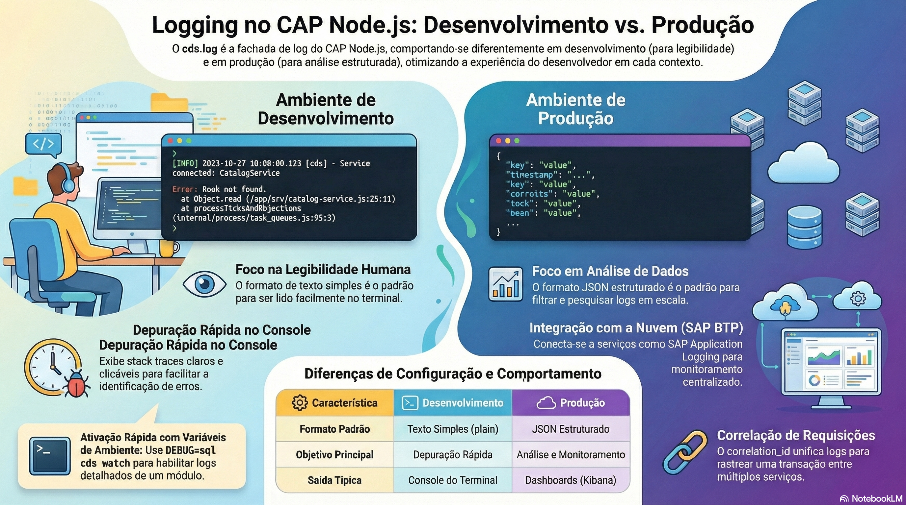

# Logs e boas práticas

> **Comece pelos slides: [Logs e boas práticas](./04.04_Logs_e_boas_praticas.pptx)**
>
> **Referência oficial (Capire):** [Minimalistic Logging Facade](https://cap.cloud.sap/docs/node.js/cds-log) · [Best Practices in Node.js](https://cap.cloud.sap/docs/node.js/best-practices)

Logs úteis em desenvolvimento e estruturados em produção, com as recomendações oficiais para dependências, segurança e erros.

## O que você vai aprender

- `cds.log(id)` devolve um logger compartilhado, usado como o `console`
- Ajuste níveis em `cds.log.levels`, ou use `DEBUG=app,sql cds watch`
- Em produção, o log é em **JSON**, pronto para os serviços de logging do SAP BTP
- O ID em `cds.context.id` vira `correlation_id` e liga os registros de uma requisição
- Use `^` no desenvolvimento e **congele** com `package-lock.json` antes do deploy
- O runtime não monta middlewares: adicione `helmet`, CSP e CORS no `bootstrap`

## Seções da aula

1. **Usando cds.log:** Cada módulo tem seu logger, com **id compartilhado** e nível ajustável.
2. **Controlando a saída:** Ligue detalhes **por módulo**, por configuração ou por uma variável de ambiente.
3. **Em produção:** O formato **JSON** é o padrão em produção, para análise em painéis.
4. **Dependências:** Receba correções durante o desenvolvimento, e **congele as versões** ao entregar.
5. **Segurança HTTP:** O runtime **não monta** middlewares do Express por conta própria. Adicione o que o seu cenário exige.
6. **Erros:** Há dois tipos de erro: os de **programação**, que se corrigem, e os de **operação**, que se tratam.
7. **Datas e números:** Pequenos cuidados evitam **perda de precisão** e divergências de horário.

---

[Voltar ao Módulo 04](../README.md) · Próxima aula: [04.05 Deploy: Cloud Foundry, Kyma e CI/CD](../../modulo-04-seguranca-e-operacao/05-deploy/README.md)
