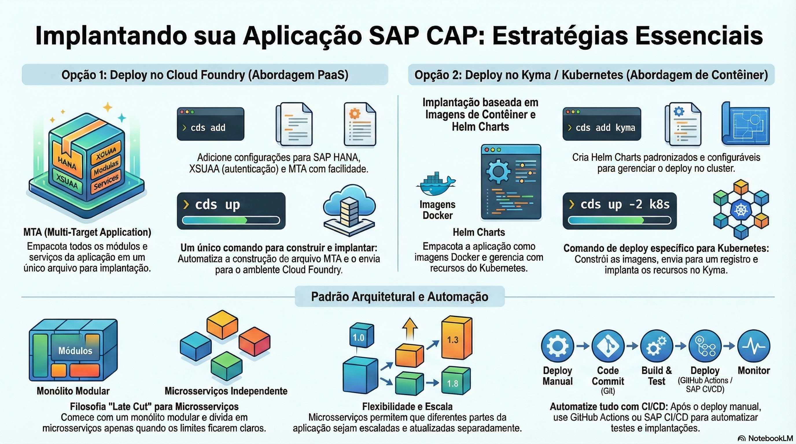

# Deploy: Cloud Foundry, Kyma e CI/CD

> **Comece pelos slides: [Deploy: Cloud Foundry, Kyma e CI/CD](./04.05_Deploy_Cloud_Foundry_Kyma_e_CICD.pptx)**
>
> **Referência oficial (Capire):** [Deployment](https://cap.cloud.sap/docs/guides/deploy/) · [Deploy to Cloud Foundry](https://cap.cloud.sap/docs/guides/deploy/to-cf) · [Deploy to Kyma](https://cap.cloud.sap/docs/guides/deploy/to-kyma) · [Customizing cds build](https://cap.cloud.sap/docs/guides/deploy/build) · [CI/CD](https://cap.cloud.sap/docs/guides/deploy/cicd)

Como levar a aplicação à nuvem: preparar serviços, gerar artefatos, implantar em Cloud Foundry ou Kyma e automatizar.

## O que você vai aprender

- `cds add` configura HANA, autenticação e deploy conforme o projeto cresce
- Cloud Foundry usa `mta.yaml`; Kyma usa imagens de contêiner e Helm
- `cds up` faz o build e a implantação em um só comando
- `cds build --production` gera os artefatos e pode ser usado para inspeção
- `cds add github-actions` cria pipelines com deploy em staging
- O endpoint `/health` já vem pronto para verificações de disponibilidade

## Seções da aula

1. **Preparando para produção:** `cds add` garante que os serviços estejam **configurados** e com as dependências certas.
2. **Build e deploy:** `cds up` faz o build e a implantação em um só comando, automatizando o que seria feito à mão.
3. **CI/CD e operação:** Depois do primeiro deploy manual, **automatize** tudo e monitore a aplicação em execução.

---

[Voltar ao Módulo 04](../README.md) · Próxima aula: [05.01 Desenvolvendo com IA: MCP Server](../../modulo-05-ia-nativa/01-desenvolvendo-com-ia/README.md)
