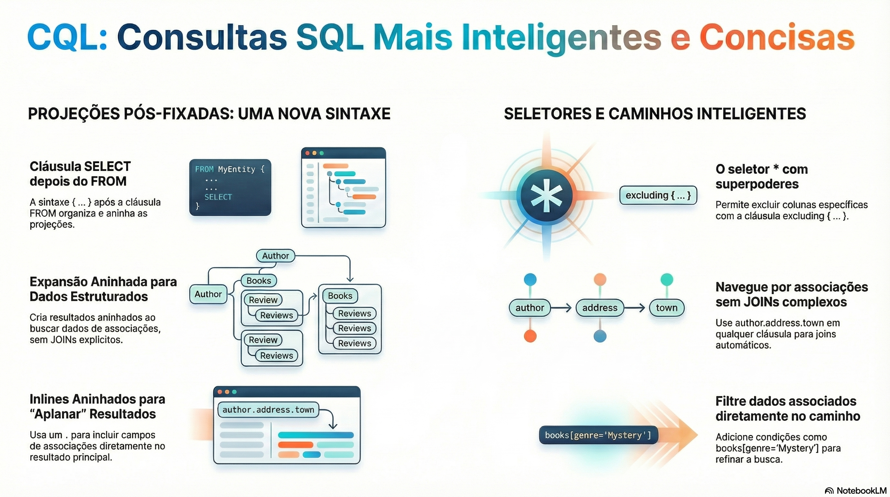

# CQL: a linguagem de consulta do CDS

> **Comece pelos slides: [CQL: a linguagem de consulta do CDS](./04.01_CQL_linguagem_de_consulta.pptx)**
>
> **Referência oficial (Capire):** [CDS Query Language](https://cap.cloud.sap/docs/cds/cql)

O que a CQL acrescenta ao SQL: projeções pós-fixadas, caminhos por associações, filtros e o seletor inteligente.

## O que você vai aprender

- A CQL estende o SQL com recursos que aproveitam as **associações** do modelo
- Projeções vêm depois do `from` e podem ser aninhadas com expand ou inline
- O `*` da CQL evita duplicidade, e `excluding` se mantém aberto a extensões
- Path expressions viram `LEFT JOIN` nas colunas e *semi-joins* no `from`
- Infix filters restringem um caminho; `exists` testa conjuntos relacionados
- Casts em CDL informam o tipo ao compilador, sem gerar cast em SQL

## Seções da aula

1. **Projeções:** A projeção depois do `from` permite aninhar campos e moldar **resultados estruturados**.
2. **O seletor inteligente:** Em projeções, o `*` é **mais esperto** que no SQL: nomes explícitos substituem as colunas repetidas.
3. **Path expressions:** Caminhos substituem joins escritos à mão: **navegue** pelo modelo em qualquer cláusula.
4. **Filtros e exists:** Colchetes restringem o caminho, e `exists` testa se algo do conjunto relacionado atende à condição.

## Material complementar

- PDF: [CQL Evolucao SQL](./04.01_CQL_Evolucao_SQL.pdf)
- Infográfico: [CQL Evolucao SQL](./04.01_CQL_Evolucao_SQL.png)

---

[Voltar ao Módulo 04](../README.md) · Próxima aula: [04.02 Consultas no Node.js com cds.ql](../../modulo-04/04.02%20-%20Consultas%20no%20Node.js%20com%20cds.ql/README.md)
