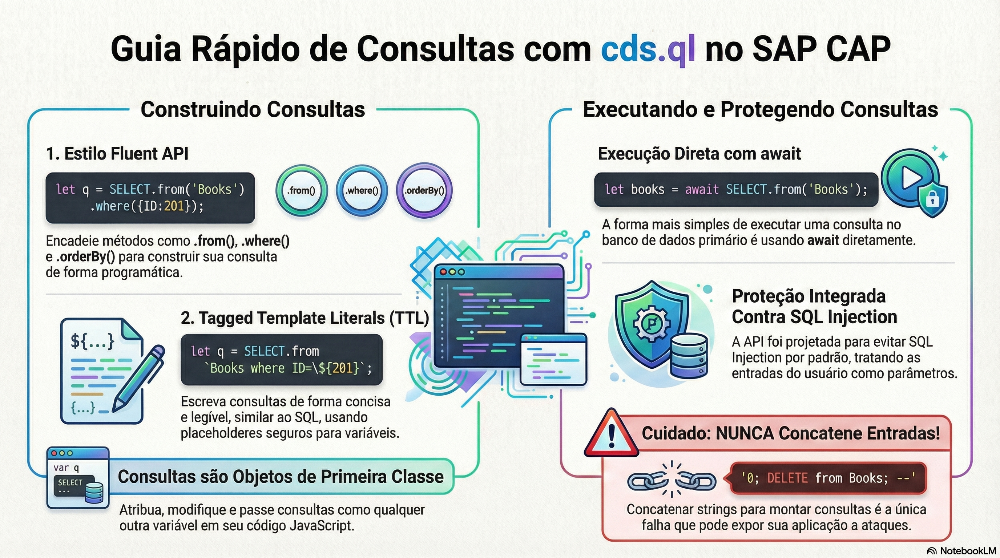

# Consultas no Node.js com cds.ql

> **Comece pelos slides: [Consultas no Node.js com cds.ql](./04.02_Consultas_no_Nodejs_com_cds_ql.pptx)**
>
> **Referência oficial (Capire):** [Querying in JavaScript](https://cap.cloud.sap/docs/node.js/cds-ql)

Como construir, executar e compor consultas em JavaScript, com segurança e sem amarrar o código ao SQL.

## O que você vai aprender

- `cds.ql` constrói consultas em CQN, sem amarrar o código ao SQL
- Prefira entidades de `cds.entities` a nomes em forma de string
- Construir não executa: use `await` ou `srv.run()`, inclusive em serviços remotos
- Compor subconsultas evita laços e deixa o trabalho para o banco
- Template strings **sem parênteses** geram parâmetros de bind
- Nunca concatene entrada do usuário ao montar uma consulta

## Seções da aula

1. **Construindo consultas:** Há estilos diferentes para o mesmo resultado, e todos produzem **CQN**.
2. **Executando:** Criar uma consulta **não a executa**. Ela só roda quando é aguardada ou enviada a um serviço.
3. **Evitando SQL injection:** A API já protege por padrão. O risco aparece só quando **você concatena** entrada do usuário.

---

[Voltar ao Módulo 04](../README.md) · Próxima aula: [04.03 Bancos de dados e DatabaseService](../../modulo-04/04.03%20-%20Bancos%20de%20dados%20e%20DatabaseService/README.md)
