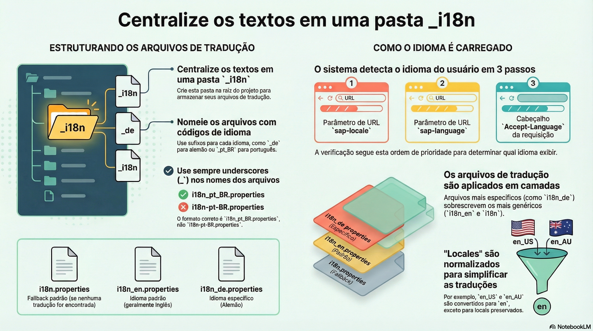

# Dados localizados

> **Comece pelos slides: [Dados localizados](./04.04_Dados_localizados.pptx)**
>
> **Referência oficial (Capire):** [Localized Data](https://cap.cloud.sap/docs/guides/uis/localized-data)

Como um único modificador traz traduções ao modelo: textos gerados, leitura pelo idioma do usuário e dados iniciais.

## O que você vai aprender

- O modificador `localized` marca os elementos que têm tradução
- O compilador gera `.texts`, as associações `texts` e `localized`, e views com fallback
- Os textos originais **permanecem** na entidade base, poupando um join
- `$user.locale` decide o idioma; em SQLite há views por idioma
- Traduções são escritas com deep insert ou por navegação em `texts`
- Carga inicial usa dois CSVs: o padrão e o `_texts`, com a coluna `locale`

## Seções da aula

1. **Nos bastidores:** O compilador **desdobra** o modificador `localized` em três partes, sem esforço de sua parte.
2. **Lendo:** Três leitores, três formas de pedir os textos: **agnóstica, por usuário e para tradução**.
3. **Escrevendo:** A tabela de textos é uma **composição**: vale deep insert, atualização e exclusão por navegação.
4. **Dados iniciais e aninhados:** Dois CSVs preenchem os textos, e dados localizados ligados por associação são **redirecionados** automaticamente.

## Material complementar

- PDF: [Localizacao Global](./04.04_Localizacao_Global.pdf)
- Infográfico: [Localizacao Global](./04.04_Localizacao_Global.png)
- Infográfico: [Localized Data Deep Dive](./04.04_Localized_Data_Deep_Dive.png)

---

[Voltar ao Módulo 04](../README.md) · Próxima aula: [04.05 Internacionalização com cds.i18n](../../modulo-04/04.05%20-%20Internacionaliza%C3%A7%C3%A3o%20com%20cds.i18n/README.md)
