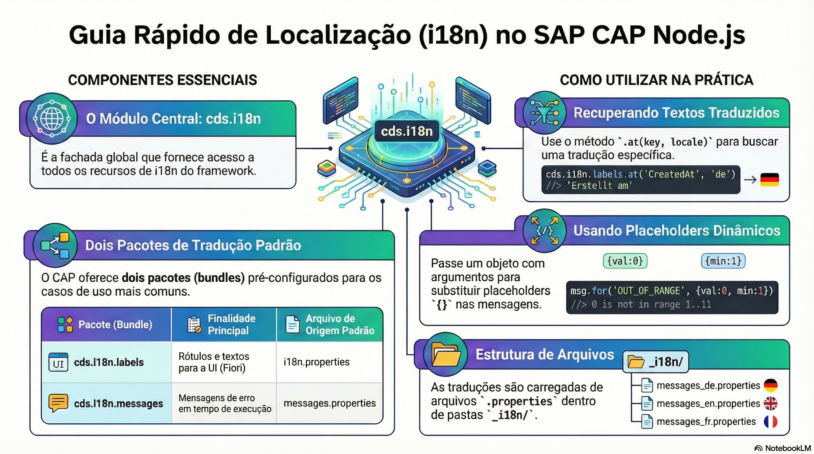

# Internacionalização com cds.i18n

> **Comece pelos slides: [Internacionalização com cds.i18n](./04.05_Internacionalizacao_com_cds_i18n.pptx)**
>
> **Referência oficial (Capire):** [Localization, i18n](https://cap.cloud.sap/docs/guides/uis/i18n) · [cds.i18n](https://cap.cloud.sap/docs/node.js/cds-i18n)

Como traduzir rótulos e mensagens: pacotes de texto, ordem de resolução e a API cds.i18n.

## O que você vai aprender

- Troque literais por chaves `{i18n>...}` e guarde os textos em `_i18n/`
- A pilha de textos é: idioma pedido, idioma padrão e reserva padrão
- O idioma vem de `sap-locale`, `sap-language` ou do cabeçalho `Accept-Language`
- Locales são **normalizados** para o idioma principal, salvo algumas exceções
- `req.reject` aceita chaves de `messages.properties`, com argumentos
- `cds.i18n.labels`, `.messages` e `bundle4()` dão acesso aos textos no código

## Seções da aula

1. **Externalizando:** Troque literais por **chaves** e guarde os textos em arquivos separados por idioma.
2. **Determinando o idioma:** O idioma vem da **requisição** e é normalizado para reduzir o número de traduções necessárias.
3. **Mensagens de runtime:** Use chaves nas mensagens de erro, e o runtime faz a tradução para o idioma do usuário.
4. **API cds.i18n:** Use os pacotes diretamente no código quando precisar de um texto traduzido **fora** dos fluxos automáticos.

---

[Voltar ao Módulo 04](../README.md) · Próxima aula: [05.01 SAP Fiori Elements com anotações](../../modulo-05/05.01%20-%20SAP%20Fiori%20Elements%20com%20anota%C3%A7%C3%B5es/README.md)
