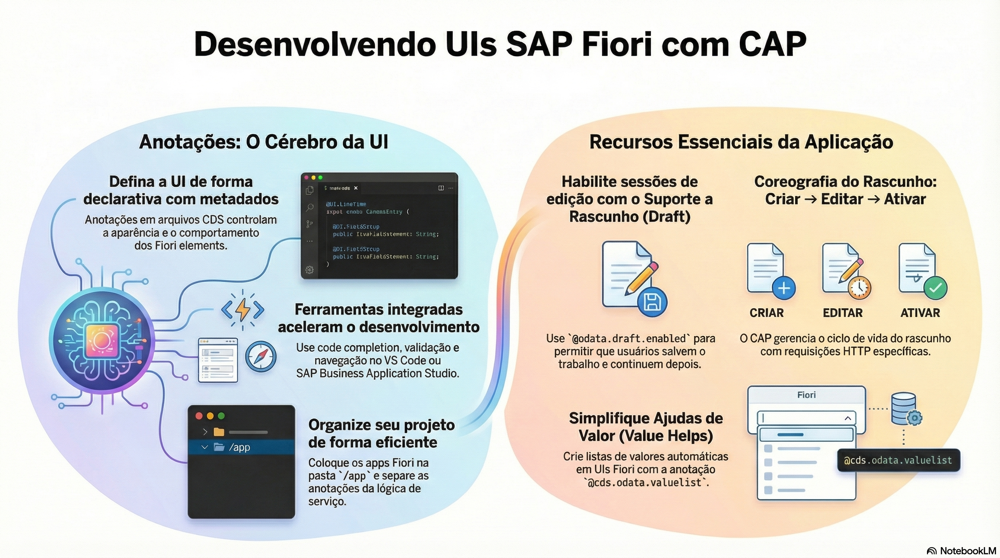

# SAP Fiori Elements com anotações

> **Comece pelos slides: [SAP Fiori Elements com anotações](./05.01_SAP_Fiori_Elements_com_anotacoes.pptx)**
>
> **Referência oficial (Capire):** [Serving Fiori UIs](https://cap.cloud.sap/docs/guides/uis/fiori)

Como as anotações viram telas: previews, organização dos arquivos, List Report, Object Page e ajudas de valor.

## O que você vai aprender

- Fiori Elements constrói a interface a partir de **metadados anotados**
- Cada app fica em uma subpasta de `app/`, com as anotações em arquivos próprios
- `SelectionFields` e `LineItem` definem o List Report
- `HeaderInfo`, `Facets` e `FieldGroup` definem a Object Page
- Prefira `@title`, `@readonly` e `@mandatory` às anotações OData equivalentes
- `@cds.odata.valuelist` e `@hierarchy` adicionam ajudas de valor e árvores

## Seções da aula

1. **Começando:** O preview já mostra uma lista sem nenhum app criado. Para uma aplicação real, use a pasta `app/`.
2. **As páginas:** Um **List Report** mostra a coleção, e uma **Object Page** mostra um registro. Ambos vêm do vocabulário `UI`.
3. **Anotações comuns:** Prefira anotações **agnósticas de protocolo** em modelos e serviços. O CAP as traduz para OData.
4. **Ajudas de valor e árvores:** Atalhos do CAP adicionam listas de valores e visualizações hierárquicas com **uma anotação**.

## Material complementar

- PDF: [Fiori Elements Metadados](./05.01_Fiori_Elements_Metadados.pdf)
- Infográfico: [Fiori Elements Metadados](./05.01_Fiori_Elements_Metadados.png)

---

[Voltar ao Módulo 05](../README.md) · Próxima aula: [05.02 Rascunhos (draft)](../../modulo-05/05.02%20-%20Rascunhos%20%28draft%29/README.md)
