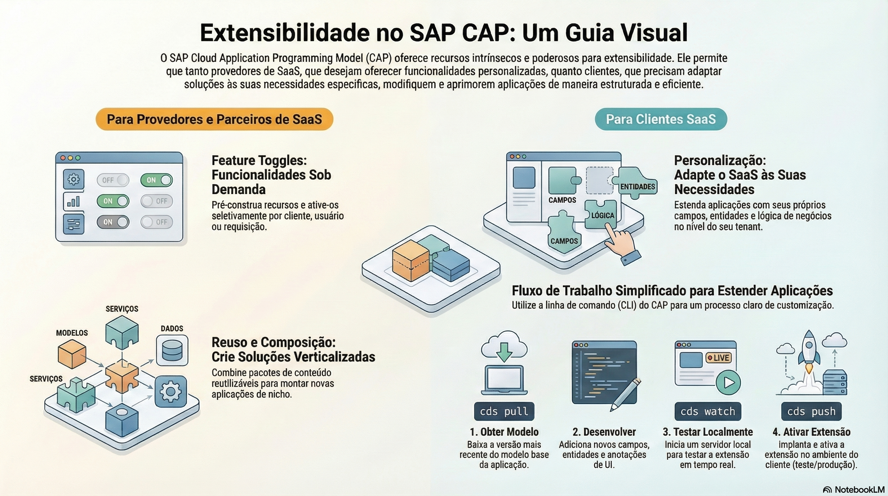

# SaaS e extensões

> **Comece pelos slides: [SaaS e extensões](./06.01_SaaS_e_extensoes.pptx)**
>
> **Referência oficial (Capire):** [Multitenancy](https://cap.cloud.sap/docs/guides/multitenancy/) · [Extensibility](https://cap.cloud.sap/docs/guides/extensibility/) · [Extending SaaS Applications](https://cap.cloud.sap/docs/guides/extensibility/customization) · [Feature Toggles](https://cap.cloud.sap/docs/guides/extensibility/feature-toggles)

Como servir vários clientes com uma implantação e adaptar a aplicação com extensões, feature toggles e pacotes.

## O que você vai aprender

- Multitenancy serve vários clientes com uma implantação, com **dados isolados**
- `cds add multitenancy` adiciona `@sap/cds-mtxs` e o sidecar em `mtx/sidecar`
- `cds subscribe` testa localmente, criando um banco por tenant
- O provedor habilita com `cds add extensibility` e limita com `extension-allowlist`
- Clientes usam `cds pull` e `cds push` em um projeto de extensão
- Feature toggles ficam em `fts/`, uma pasta por recurso, e valem por tenant

## Seções da aula

1. **Habilitando:** Um comando prepara o projeto. As operações pesadas de SaaS ficam em um **sidecar**.
2. **Testando localmente:** Antes de ir para a nuvem, simule início do SaaS, subscrição e atualização na sua máquina.
3. **Extensões de clientes:** Tudo no CAP é **extensível por padrão**. O provedor libera e limita; o cliente desenvolve seu projeto de extensão.
4. **Feature toggles:** O provedor entrega **melhorias prontas** como modelos CDS, que são ativadas por tenant, usuário ou requisição.
5. **Reuso e composição:** Pacotes npm trazem **modelos, código, dados e UIs** para novos projetos.

---

[Voltar ao Módulo 06](../README.md) · Próxima aula: [06.02 Criando plugins do CAP](../../modulo-06-avancado/02-plugins/README.md)
