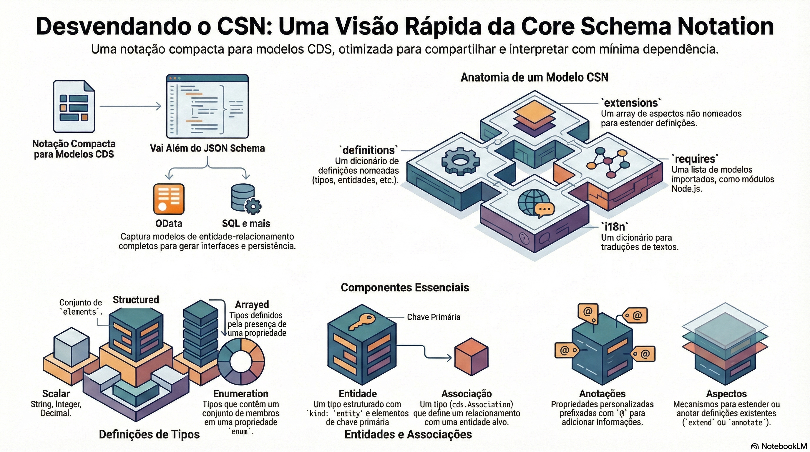

# CSN, CQN e CXN

> **Comece pelos slides: [CSN, CQN e CXN](./06.03_CSN_CQN_e_CXN.pptx)**
>
> **Referência oficial (Capire):** [CSN Reference](https://cap.cloud.sap/docs/cds/csn) · [CQN Reference](https://cap.cloud.sap/docs/cds/cqn) · [CXN Reference](https://cap.cloud.sap/docs/cds/cxn)

Por dentro das notações que representam modelos, consultas e expressões como objetos simples.

## O que você vai aprender

- CSN é a notação compacta dos modelos CDS, em JSON, YAML ou objeto JavaScript
- Cada definição tem `kind`, com nome totalmente qualificado como chave
- Associações usam `target`, `cardinality`, `on` e `keys`
- CQN representa consultas em objetos simples, e CXN representa as expressões
- Em `SELECT`, só `from` é obrigatório; `columns` aceita projeções aninhadas
- Expressões combinam `val`, `ref`, `func`, `xpr`, `list` e `param`

## Seções da aula

1. **Anatomia:** Um documento CSN tem **quatro propriedades de topo**, todas opcionais.
2. **Entidades e relações:** Do `.cds` ao CSN: compilamos um modelo real para ver como cada conceito é representado.
3. **A estrutura do CQN:** Parsing, API fluente ou objeto literal: **três caminhos** que levam à mesma consulta.
4. **Expressões em CXN:** Toda expressão é uma combinação de poucos blocos, com um objeto por tipo.

---

[Voltar ao Módulo 06](../README.md) · Próxima aula: [06.04 Compilador e reflexão](../../modulo-06-avancado/04-compilador-e-reflexao/README.md)
