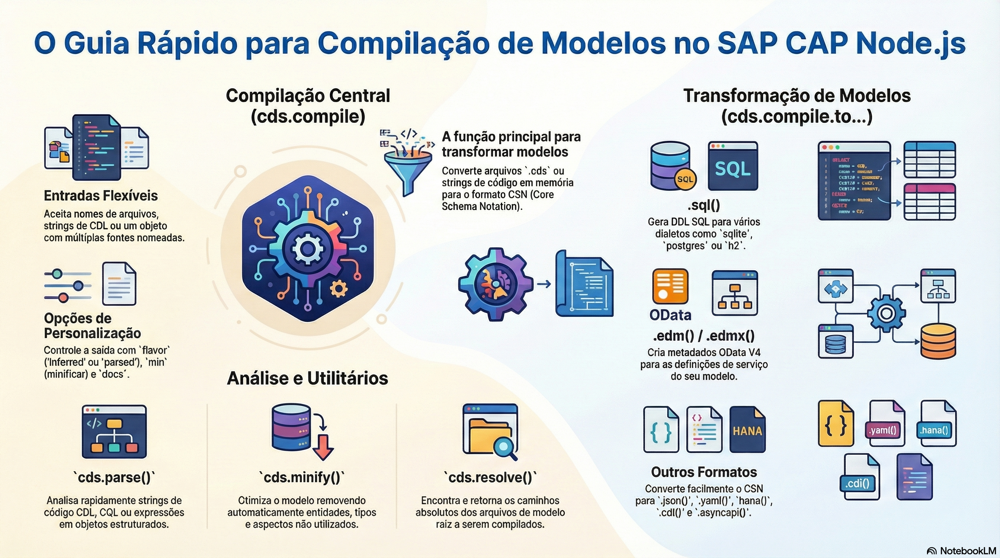

# Compilador e reflexão

> **Comece pelos slides: [Compilador e reflexão](./06.04_Compilador_e_reflexao.pptx)**
>
> **Referência oficial (Capire):** [cds.compile](https://cap.cloud.sap/docs/node.js/cds-compile) · [cds.reflect](https://cap.cloud.sap/docs/node.js/cds-reflect) · [Command Line Interface](https://cap.cloud.sap/docs/tools/cds-cli)

Como o compilador transforma CDS em artefatos, o que suas mensagens dizem e como navegar pelo modelo em tempo de execução.

## O que você vai aprender

- `cds.compile` aceita arquivos ou textos em memória e devolve CSN
- `cds.compile.to` gera SQL, EDMX e outros artefatos
- Eventos como `compile.to.edmx` permitem interceptar a geração
- Mensagens têm ID, e as explicações ficam em `@sap/cds-compiler/share/messages`
- `cds.linked` (ou `cds.reflect`) transforma CSN em modelo navegável
- `each`, `all`, `find` e `foreach` filtram por `kind` ou por função

## Seções da aula

1. **cds.compile:** A função central aceita **arquivos** ou **textos em memória**, e devolve o modelo em CSN.
2. **Gerando artefatos:** A partir do CSN, processadores geram tudo o que banco e clientes precisam.
3. **Mensagens do compilador:** O compilador é um aliado: suas mensagens têm um **ID** e explicações oficiais no pacote.
4. **cds.linked:** O próprio modelo é modificado e devolvido. Pode ser chamado de novo **sem custo extra**.
5. **Consultando definições:** Filtre por tipo ou por função, e percorra apenas o que interessa.
6. **O sistema de tipos:** Todas as definições são instâncias de um **conjunto de classes**, que podem ser ampliadas.

---

[Voltar ao Módulo 06](../README.md) · Próxima aula: [06.05 Runtime e fachada cds](../../modulo-06-avancado/05-runtime-e-fachada/README.md)
