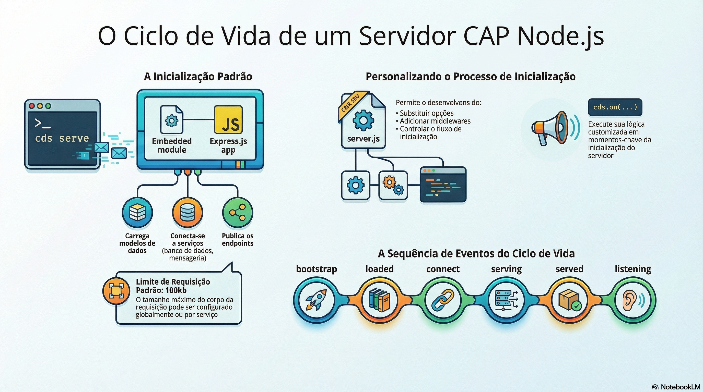

# Runtime e fachada cds

> **Comece pelos slides: [Runtime e fachada cds](./06.05_Runtime_e_fachada_cds.pptx)**
>
> **Referência oficial (Capire):** [cds.server](https://cap.cloud.sap/docs/node.js/cds-server) · [cds.serve](https://cap.cloud.sap/docs/node.js/cds-serve) · [The cds Facade Object](https://cap.cloud.sap/docs/node.js/cds-facade) · [cds.utils](https://cap.cloud.sap/docs/node.js/cds-utils)

Do comando cds serve à primeira requisição, e um passeio pelo objeto cds e pelos utilitários do dia a dia.

## O que você vai aprender

- `cds serve` usa o `server.js` embutido: Express, modelo, conexões e serviços
- Um `server.js` próprio registra em eventos ou delega a `cds.server`
- `bootstrap`, `served`, `listening` e `shutdown` marcam as etapas
- `cds.middlewares.add` ajusta a cadeia, e `@protocol` e `@path` definem o acesso
- `cds` é o ponto de entrada de todas as APIs do CAP em Node.js
- `cds.utils` reúne `uuid`, `ms4`, `read`, `write`, `copy` e `colors`

## Seções da aula

1. **O server.js:** O `server.js` embutido cria o app Express e inicia todos os serviços CAP.
2. **Eventos do ciclo de vida:** Eventos emitidos pela fachada `cds` marcam **cada etapa** do processo.
3. **cds.serve:** A API fluente constrói os serviços. Em geral, `cds.serve('all')` basta.
4. **Middlewares e protocolos:** Cada serviço recebe uma **cadeia de middlewares** antes do adaptador de protocolo.
5. **A fachada cds:** Importe **sempre** pela fachada. Experimente as APIs no `cds repl`.
6. **cds.utils:** Pequenas funções evitam **reescrever o básico**: identificadores, arquivos e cores.

---

[Voltar ao Módulo 06](../README.md)
