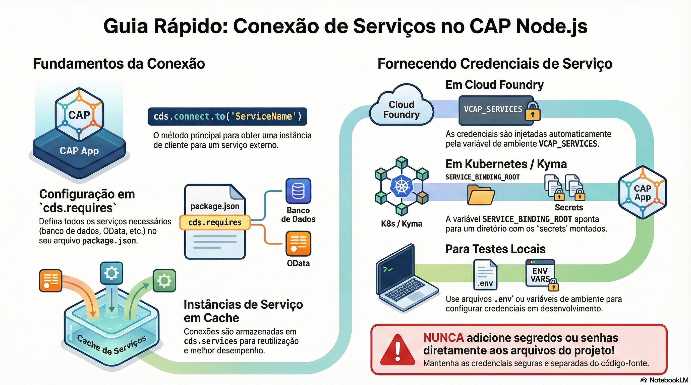

# Conexões e service bindings

> **Comece pelos slides: [Conexões e service bindings](./06.02_Conexoes_e_service_bindings.pptx)**
>
> **Referência oficial (Capire):** [cds.connect](https://cap.cloud.sap/docs/node.js/cds-connect) · [cds bind](https://cap.cloud.sap/docs/tools/cds-bind)

Como o nome de um serviço vira uma conexão real: cds.connect, cds.requires e bindings em cada ambiente.

## O que você vai aprender

- `cds.connect.to()` devolve um cliente para serviços locais, remotos e bancos
- Instâncias conectadas pelo nome ficam em cache em `cds.services`
- `cds.requires` declara `kind`, `impl`, `model` e `service` de cada serviço
- O binding preenche `credentials`: **segredos nunca** entram nos arquivos do projeto
- CF usa `VCAP_SERVICES`, Kyma usa `SERVICE_BINDING_ROOT`, e o teste local usa `.env`
- Destinations podem ser nomeadas no SAP BTP ou definidas na aplicação

## Seções da aula

1. **cds.connect:** Um único método conecta a serviços **locais, externos e de banco**, sempre devolvendo um objeto `Service`.
2. **cds.requires:** Cada entrada diz que o serviço **não** é servido pela aplicação, mas conectado a ela.
3. **Service bindings:** O binding preenche `credentials`. Por isso, **segredos não entram** em `package.json` nem em `.cdsrc.json`.
4. **Destinations:** Destinations nomeadas ficam no **SAP BTP**. Sem elas, a URL pode ser definida na própria aplicação.

---

[Voltar ao Módulo 06](../README.md) · Próxima aula: [06.03 Eventos e mensageria](../../modulo-06/06.03%20-%20Eventos%20e%20mensageria/README.md)
