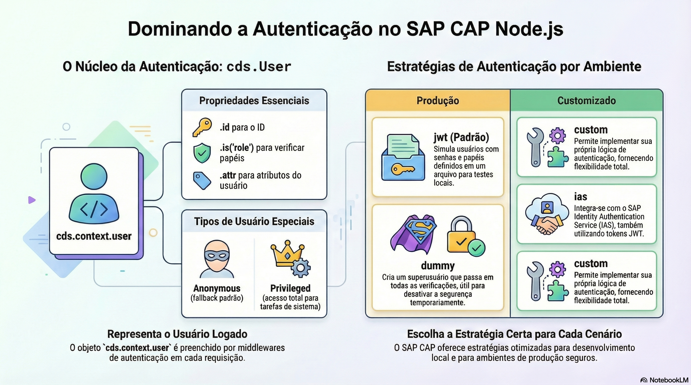

# Autenticação e usuários

> **Comece pelos slides: [Autenticação e usuários](./07.01_Autenticacao_e_usuarios.pptx)**
>
> **Referência oficial (Capire):** [Authentication](https://cap.cloud.sap/docs/guides/security/authentication) · [CAP Users](https://cap.cloud.sap/docs/guides/security/cap-users) · [Authentication in Node.js](https://cap.cloud.sap/docs/node.js/authentication)

Como o CAP identifica quem chama a aplicação: o usuário CAP, as estratégias de autenticação e os serviços IAS e XSUAA.

## O que você vai aprender

- Autenticação diz **quem** usa o serviço e é pré-requisito da autorização
- `req.user` traz `id`, `attr` e `is()`, independentemente da estratégia
- Pseudopapéis como `authenticated-user` e `system-user` vêm da própria autenticação
- `mocked` serve ao desenvolvimento e **nunca** deve ir para produção
- Em produção, o padrão é `jwt`, com todos os endpoints autenticados
- IAS é a primeira escolha; XSUAA atende aplicações existentes

## Seções da aula

1. **O usuário CAP:** Após a autenticação, o usuário fica disponível em `req.user`, **desacoplado** da estratégia utilizada.
2. **Desenvolvimento:** Sem serviço de identidade, usuários simulados permitem **testar papéis** na sua máquina.
3. **Produção:** Na nuvem, a estratégia padrão é `jwt`, e **todos os endpoints** exigem autenticação.

---

[Voltar ao Módulo 07](../README.md) · Próxima aula: [07.02 Autorização com @requires e @restrict](../../modulo-07/07.02%20-%20Autoriza%C3%A7%C3%A3o%20com%20@requires%20e%20@restrict/README.md)
