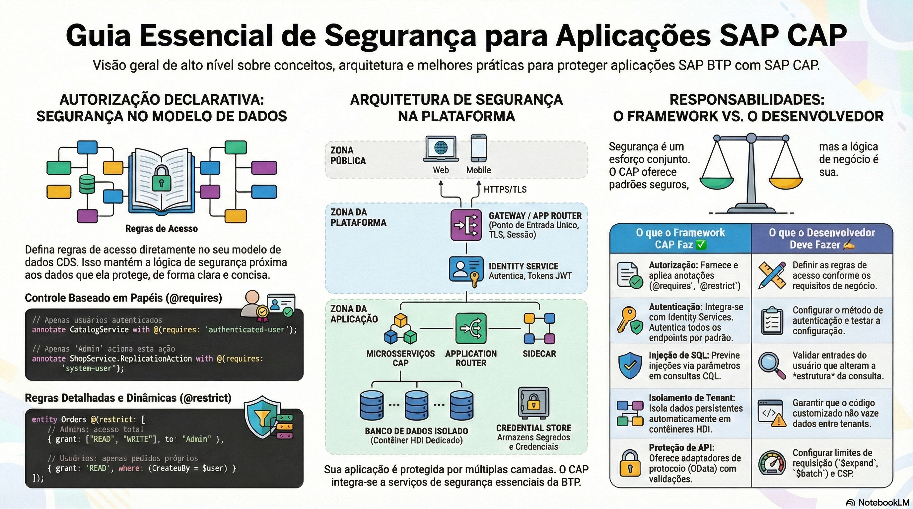

# Autorização com @requires e @restrict

> **Comece pelos slides: [Autorização com @requires e @restrict](./07.02_Autorizacao_com_requires_e_restrict.pptx)**
>
> **Referência oficial (Capire):** [Authorization](https://cap.cloud.sap/docs/guides/security/authorization) · [Security Overview](https://cap.cloud.sap/docs/guides/security/overview)

Como declarar o que cada papel pode fazer, com restrições estáticas, por papel e por instância.

## O que você vai aprender

- Regras ficam **no modelo**, e o framework genérico as aplica
- Sem modelagem, serviços CDS **não têm** controle de acesso
- `@requires` exige papéis; `@restrict` define privilégios com `grant`, `to` e `where`
- Restrições combinam serviço, entidade e ação; projeções herdam as regras
- `where` filtra por instância, usando `$user` e `$user.<atributo>`
- Prefira papéis de negócio e um serviço por papel ou caso de uso

## Seções da aula

1. **Controle estático:** Restringe operações para **todos os usuários**, sem depender de papéis.
2. **Controle por papel:** Restrições respondem a **o quê** (evento), **quem** (papel) e **qual** (filtro).
3. **Controle por instância:** A condição `where` age como um **filtro**: o usuário só alcança os registros que atendem a ela.
4. **Boas práticas:** Flexibilidade demais pode virar **falha de segurança**. Modelos simples são mais fáceis de auditar.

## Material complementar

- PDF: [Seguranca e Autenticacao](./07.02_Seguranca_e_Autenticacao.pdf)
- Infográfico: [Seguranca e Autenticacao](./07.02_Seguranca_e_Autenticacao.png)

---

[Voltar ao Módulo 07](../README.md) · Próxima aula: [07.03 Privacidade de dados e audit log](../../modulo-07/07.03%20-%20Privacidade%20de%20dados%20e%20audit%20log/README.md)
