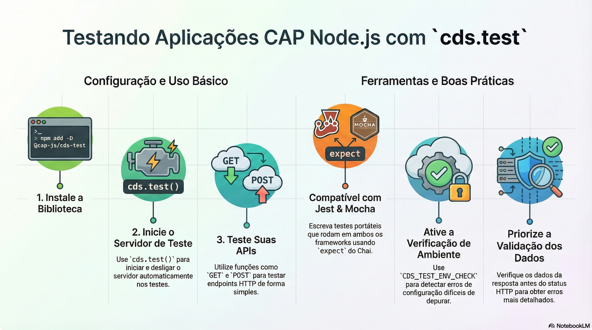

# Testes automatizados com cds-test

> **Comece pelos slides: [Testes automatizados com cds-test](./08.01_Testes_automatizados_com_cds_test.pptx)**
>
> **Referência oficial (Capire):** [Testing with cds.test](https://cap.cloud.sap/docs/node.js/cds-test)

Como testar serviços CAP de ponta a ponta com cds.test: servidor real, HTTP, usuários e banco.

## O que você vai aprender

- `cds.test()` inicia um **servidor real** e deve ser a primeira chamada do teste
- `GET`, `POST` e `defaults` simplificam chamadas HTTP autenticadas
- A API direta do serviço cobre o que não é acessível por HTTP
- `data.reset` reimplanta o banco, e `cds.test.log()` captura a saída
- Compare códigos e subconjuntos, e não mensagens nem respostas inteiras
- Use a API comum para os testes rodarem em Node, Vitest, Jest ou Mocha

## Seções da aula

1. **Primeiro teste:** Instale o pacote de desenvolvimento e escreva um teste que inicia o servidor na primeira linha.
2. **Testando serviços:** Teste pela **API HTTP**, ou chame o serviço direto no código quando for testar a lógica interna.
3. **Boas práticas:** Testes resistentes verificam **apenas o que importa** e se mantêm independentes do runner.

---

[Voltar ao Módulo 08](../README.md) · Próxima aula: [08.02 Logging e observabilidade](../../modulo-08/08.02%20-%20Logging%20e%20observabilidade/README.md)
