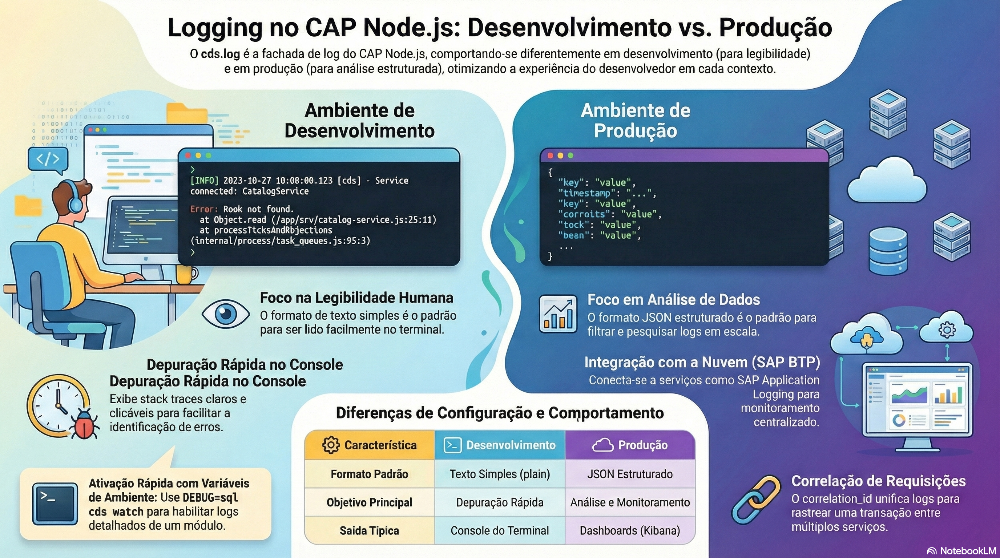

# Logging e observabilidade

> **Comece pelos slides: [Logging e observabilidade](./08.02_Logging_e_observabilidade.pptx)**
>
> **Referência oficial (Capire):** [Minimalistic Logging Facade](https://cap.cloud.sap/docs/node.js/cds-log)

Como usar cds.log para ter logs úteis no desenvolvimento e estruturados em produção, com rastreio das requisições.

## O que você vai aprender

- `cds.log(id)` devolve um logger compartilhado, usado como o `console`
- Evite formatar mensagens de debug: passe argumentos e verifique `_debug`
- Ajuste níveis em `cds.log.levels`, ou use `DEBUG=app,sql cds watch`
- Em produção, o log é em **JSON**, pronto para os serviços de logging do SAP BTP
- `cds.log.mask_headers` protege cabeçalhos sensíveis
- O ID em `cds.context.id` vira `correlation_id` e liga os registros de uma requisição

## Seções da aula

1. **Usando cds.log:** Cada módulo tem seu logger, com **id compartilhado** e nível ajustável.
2. **Controlando a saída:** Ligue detalhes **por módulo**, por configuração ou por uma variável de ambiente.
3. **Em produção:** O formato **JSON** é o padrão em produção, para análise em painéis.
4. **Correlação:** Um **ID de correlação** liga os registros de uma requisição, mesmo entre aplicações diferentes.

## Material complementar

- PDF: [Logging Dev Producao](./08.02_Logging_Dev_Producao.pdf)
- Infográfico: [Logging Dev Producao](./08.02_Logging_Dev_Producao.png)

---

[Voltar ao Módulo 08](../README.md) · Próxima aula: [08.03 Deploy: Cloud Foundry, Kyma e CI/CD](../../modulo-08/08.03%20-%20Deploy%20-%20Cloud%20Foundry,%20Kyma%20e%20CI-CD/README.md)
