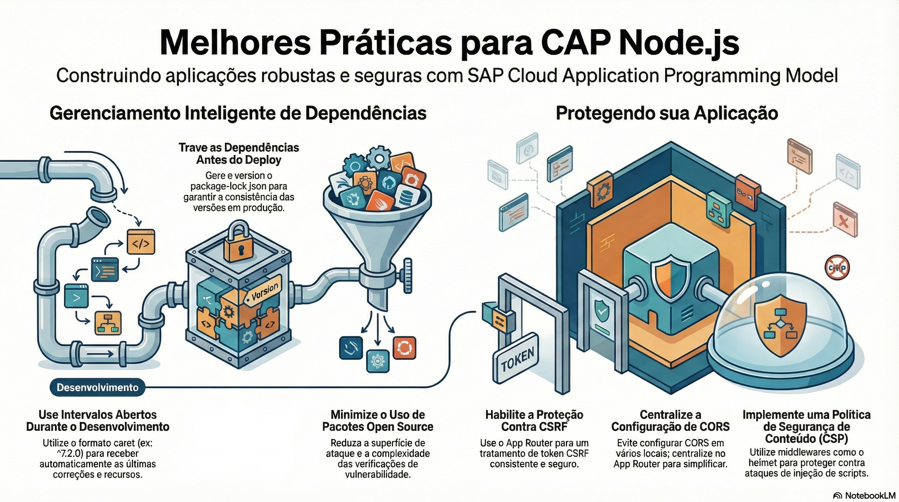

# Boas práticas para produção

> **Comece pelos slides: [Boas práticas para produção](./08.04_Boas_praticas_para_producao.pptx)**
>
> **Referência oficial (Capire):** [Best Practices in Node.js](https://cap.cloud.sap/docs/node.js/best-practices)

Recomendações oficiais para Node.js: dependências, segurança HTTP, tratamento de erros e valores numéricos.

## O que você vai aprender

- Use `^` no desenvolvimento e **congele** com `package-lock.json` antes do deploy
- Faça verificações de vulnerabilidade e adote novas majors cedo
- O runtime não monta middlewares: adicione `helmet`, CSP e CORS no `bootstrap`
- Configure CORS em um só lugar, no App Router ou no servidor CAP
- Deixe falhar o inesperado e não esconda a origem dos erros
- `Decimal` e `Int64` chegam como strings: faça as contas no banco

## Seções da aula

1. **Dependências:** Receba correções durante o desenvolvimento, e **congele as versões** ao entregar.
2. **Segurança HTTP:** O runtime **não monta** middlewares do Express por conta própria. Adicione o que o seu cenário exige.
3. **Erros:** Há dois tipos de erro: os de **programação**, que se corrigem, e os de **operação**, que se tratam.
4. **Datas e números:** Pequenos cuidados evitam **perda de precisão** e divergências de horário.

---

[Voltar ao Módulo 08](../README.md) · Próxima aula: [09.01 Multitenancy com MTX](../../modulo-09/09.01%20-%20Multitenancy%20com%20MTX/README.md)
