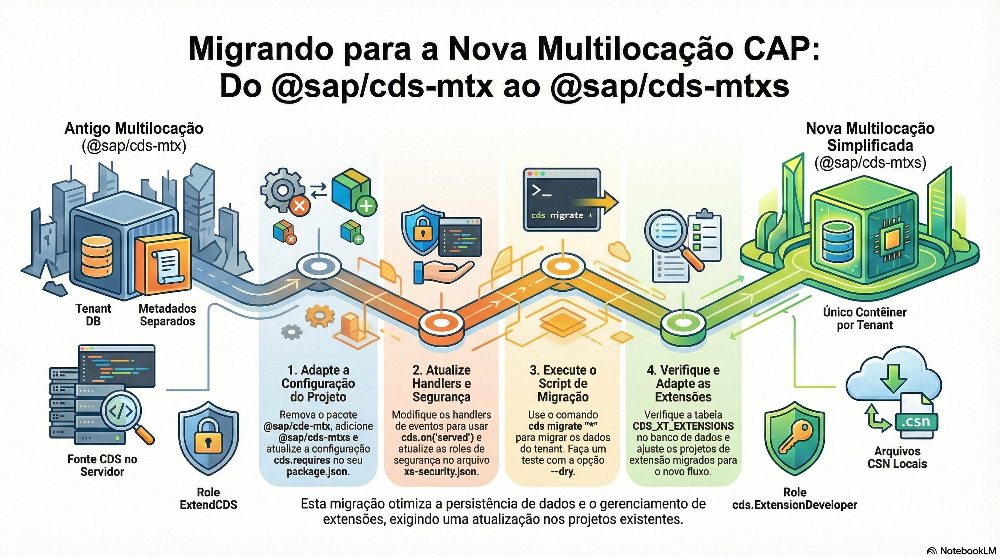

# Multitenancy com MTX

> **Comece pelos slides: [Multitenancy com MTX](./09.01_Multitenancy_com_MTX.pptx)**
>
> **Referência oficial (Capire):** [Multitenancy](https://cap.cloud.sap/docs/guides/multitenancy/) · [MTX Reference](https://cap.cloud.sap/docs/guides/multitenancy/mtxs)

Como servir vários clientes com uma implantação, isolando os dados: sidecar, subscrições e atualização de tenants.

## O que você vai aprender

- Multitenancy serve vários clientes com uma implantação, com **dados isolados**
- `cds add multitenancy` adiciona `@sap/cds-mtxs` e o sidecar em `mtx/sidecar`
- O sidecar assume `subscribe` e `upgrade`, que são operações pesadas
- `cds subscribe` testa localmente, criando um banco por tenant
- `cds-mtx upgrade` atualiza o esquema, por comando, API, hook ou job
- Serviços MTX aceitam handlers próprios, e dependências SaaS são configuráveis

## Seções da aula

1. **Habilitando:** Um comando prepara o projeto. As operações pesadas de SaaS ficam em um **sidecar**.
2. **Testando localmente:** Antes de ir para a nuvem, simule início do SaaS, subscrição e atualização na sua máquina.
3. **Na nuvem:** O deploy é o mesmo, com o acréscimo da subscrição pelo **SAP BTP**.
4. **Personalizando o SaaS:** Serviços MTX são **serviços CAP comuns**: aceitam handlers, e dependências são declaradas em configuração.

---

[Voltar ao Módulo 09](../README.md) · Próxima aula: [09.02 Extensibilidade e feature toggles](../../modulo-09/09.02%20-%20Extensibilidade%20e%20feature%20toggles/README.md)
