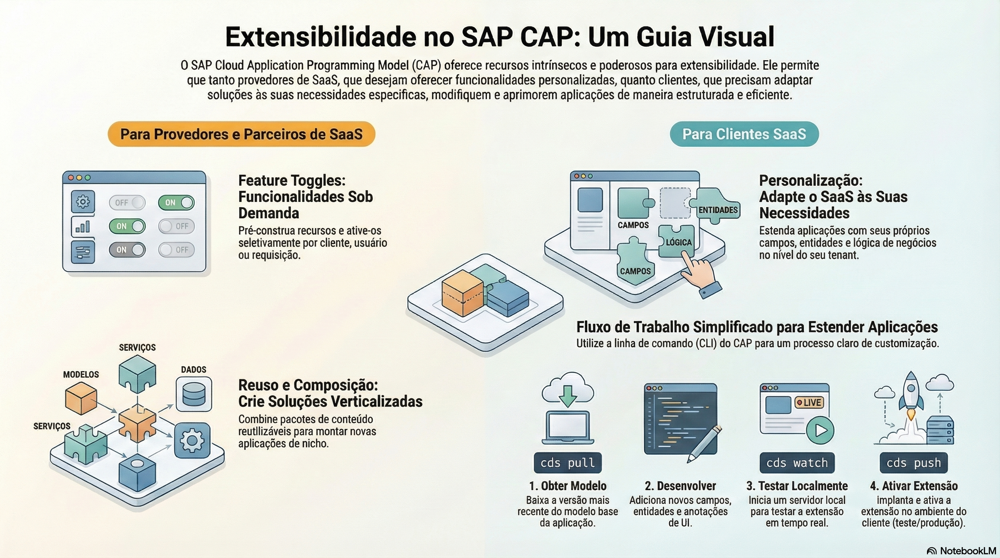

# Extensibilidade e feature toggles

> **Comece pelos slides: [Extensibilidade e feature toggles](./09.02_Extensibilidade_e_feature_toggles.pptx)**
>
> **Referência oficial (Capire):** [Extensibility](https://cap.cloud.sap/docs/guides/extensibility/) · [Extending SaaS Applications](https://cap.cloud.sap/docs/guides/extensibility/customization) · [Feature Toggles](https://cap.cloud.sap/docs/guides/extensibility/feature-toggles) · [Reuse & Compose](https://cap.cloud.sap/docs/guides/integration/reuse-and-compose)

As formas de adaptar uma aplicação CAP: extensões de clientes, recursos ligados por tenant e reuso de pacotes.

## O que você vai aprender

- Extensibilidade no CAP se baseia em **aspectos do CDS**
- O provedor habilita com `cds add extensibility` e limita com `extension-allowlist`
- Clientes usam `cds pull` e `cds push` em um projeto de extensão
- Feature toggles ficam em `fts/`, uma pasta por recurso, e valem por tenant
- Em produção, a aplicação deve trazer seu próprio provedor de toggles
- Pacotes npm permitem reutilizar modelos, código, dados e UIs

## Seções da aula

1. **Extensões de clientes:** Tudo no CAP é **extensível por padrão**. O provedor libera e limita; o cliente desenvolve seu projeto de extensão.
2. **Feature toggles:** O provedor entrega **melhorias prontas** como modelos CDS, que são ativadas por tenant, usuário ou requisição.
3. **Reuso e composição:** Pacotes npm trazem **modelos, código, dados e UIs** para novos projetos.

## Material complementar

- PDF: [Extensibility Toolkit](./09.02_Extensibility_Toolkit.pdf)
- Infográfico: [Extensibility Toolkit](./09.02_Extensibility_Toolkit.png)

---

[Voltar ao Módulo 09](../README.md) · Próxima aula: [09.03 Criando plugins do CAP](../../modulo-09/09.03%20-%20Criando%20plugins%20do%20CAP/README.md)
