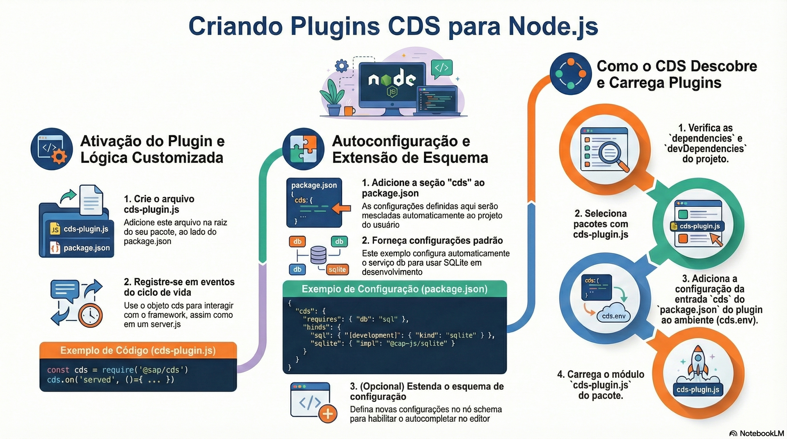

# Criando plugins do CAP

> **Comece pelos slides: [Criando plugins do CAP](./09.03_Criando_plugins_do_CAP.pptx)**
>
> **Referência oficial (Capire):** [cds-plugin](https://cap.cloud.sap/docs/node.js/cds-plugins) · [CAP Plugins](https://cap.cloud.sap/docs/plugins/)

Como criar extensões reutilizáveis que se ativam sozinhas, com configuração automática e schemas.

## O que você vai aprender

- Um plugin é um pacote com `cds-plugin.js` ao lado do `package.json`
- O CAP detecta plugins nas dependências e carrega cada um no bootstrap
- A seção `cds` do plugin é mesclada a `cds.env`: isso é a **autoconfiguração**
- `@cap-js/sqlite` funciona assim, por isso basta instalar
- Schemas (beta) acrescentam autocompletar para opções de plugins
- Antes de criar um plugin, procure no catálogo oficial de plugins

## Seções da aula

1. **Criando um plugin:** Basta um arquivo no pacote. Dentro dele, a fachada `cds` dá acesso ao ciclo de vida do framework.
2. **Autoconfiguração:** O plugin leva **configurações prontas** no próprio `package.json`.
3. **Schemas de configuração:** Um schema (beta) descreve as opções do plugin e dá **autocompletar** a quem usa.
4. **O ecossistema:** Antes de escrever um plugin, veja se **já existe** um para o seu caso.

---

[Voltar ao Módulo 09](../README.md) · Próxima aula: [10.01 CSN: o modelo em JSON](../../modulo-10/10.01%20-%20CSN%20-%20o%20modelo%20em%20JSON/README.md)
