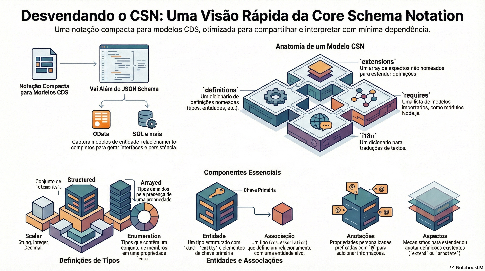

# CSN: o modelo em JSON

> **Comece pelos slides: [CSN: o modelo em JSON](./10.01_CSN_o_modelo_em_JSON.pptx)**
>
> **Referência oficial (Capire):** [CSN Reference](https://cap.cloud.sap/docs/cds/csn)

Por dentro da notação que representa todo modelo CDS: anatomia, definições, relações, anotações e extensões.

## O que você vai aprender

- CSN é a notação compacta dos modelos CDS, em JSON, YAML ou objeto JavaScript
- Tem `requires`, `definitions`, `extensions` e `i18n`, todos opcionais
- Cada definição tem `kind`, com nome totalmente qualificado como chave
- Anotações viram propriedades com prefixo `@`
- Associações usam `target`, `cardinality`, `on` e `keys`
- Views e projeções guardam uma consulta em CQN

## Seções da aula

1. **Anatomia:** Um documento CSN tem **quatro propriedades de topo**, todas opcionais.
2. **Entidades e relações:** Do `.cds` ao CSN: compilamos um modelo real para ver como cada conceito é representado.
3. **Serviços e extensões:** Serviços e ações são definições como outras. Extensões ficam guardadas até serem aplicadas.

---

[Voltar ao Módulo 10](../README.md) · Próxima aula: [10.02 CQN e CXN: consultas e expressões como dados](../../modulo-10/10.02%20-%20CQN%20e%20CXN%20-%20consultas%20e%20express%C3%B5es%20como%20dados/README.md)
