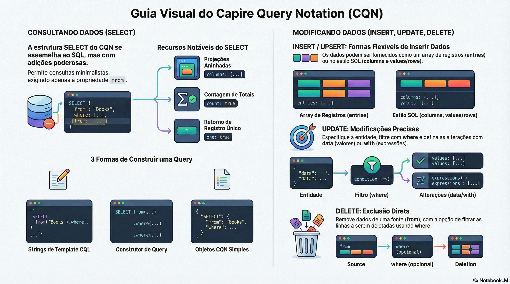

# CQN e CXN: consultas e expressões como dados

> **Comece pelos slides: [CQN e CXN: consultas e expressões como dados](./10.02_CQN_e_CXN.pptx)**
>
> **Referência oficial (Capire):** [CQN Reference](https://cap.cloud.sap/docs/cds/cqn) · [CXN Reference](https://cap.cloud.sap/docs/cds/cxn)

Como consultas e expressões viram objetos simples: a estrutura de SELECT, INSERT, UPDATE, DELETE e dos blocos ref, val e xpr.

## O que você vai aprender

- CQN representa consultas em objetos simples, e CXN representa as expressões
- Parsing, API fluente e objetos literais levam à mesma consulta
- Em `SELECT`, só `from` é obrigatório; `columns` aceita projeções aninhadas
- `UPDATE` usa `data` para valores e `with` para expressões
- Expressões combinam `val`, `ref`, `func`, `xpr`, `list` e `param`
- `xpr` guarda operadores como strings, sem interpretá-los

## Seções da aula

1. **A estrutura do CQN:** Parsing, API fluente ou objeto literal: **três caminhos** que levam à mesma consulta.
2. **Expressões em CXN:** Toda expressão é uma combinação de poucos blocos, com um objeto por tipo.

## Material complementar

- Infográfico: [CQN Desconstrucao Arquitetural](./10.02_CQN_Desconstrucao_Arquitetural.png)
- Infográfico: [CXN The CDS Blueprint](./10.02_CXN_The_CDS_Blueprint.png)

---

[Voltar ao Módulo 10](../README.md) · Próxima aula: [10.03 O compilador CDS](../../modulo-10/10.03%20-%20O%20compilador%20CDS/README.md)
