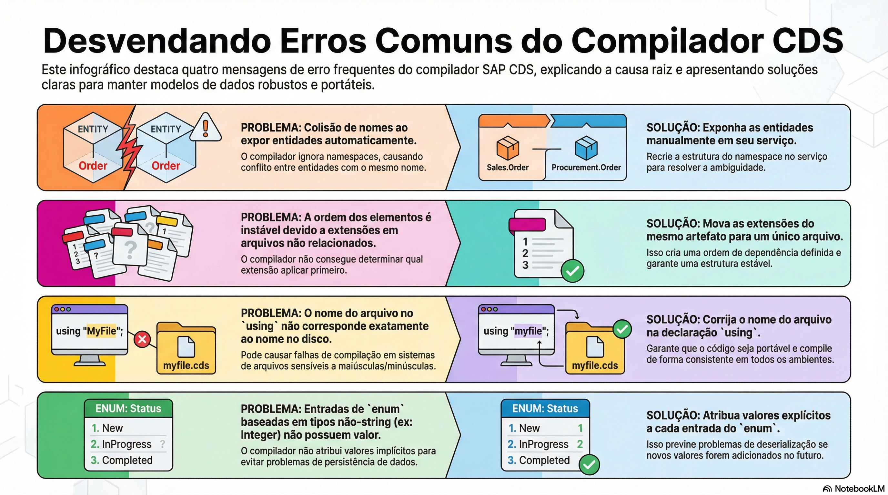

# O compilador CDS

> **Comece pelos slides: [O compilador CDS](./10.03_O_compilador_CDS.pptx)**
>
> **Referência oficial (Capire):** [cds.compile](https://cap.cloud.sap/docs/node.js/cds-compile) · [Command Line Interface](https://cap.cloud.sap/docs/tools/cds-cli)

Como o compilador transforma CDS em CSN e em artefatos finais, e o que suas mensagens querem dizer.

## O que você vai aprender

- `cds.compile` aceita arquivos ou textos em memória e devolve CSN
- Por padrão, o CSN é `inferred`; `parsed` mantém o modelo apenas analisado
- `cds.parse` analisa CDL, CQL e expressões separadamente
- `cds.compile.to` gera SQL, EDMX e outros artefatos
- Eventos como `compile.to.edmx` permitem interceptar a geração
- Mensagens têm ID, e as explicações ficam em `@sap/cds-compiler/share/messages`

## Seções da aula

1. **cds.compile:** A função central aceita **arquivos** ou **textos em memória**, e devolve o modelo em CSN.
2. **Gerando artefatos:** A partir do CSN, processadores geram tudo o que banco e clientes precisam.
3. **Mensagens do compilador:** O compilador é um aliado: suas mensagens têm um **ID** e explicações oficiais no pacote.

## Material complementar

- Infográfico: [CDS Compiler Mastery](./10.03_CDS_Compiler_Mastery.png)
- Infográfico: [Compiler Deep Dive](./10.03_Compiler_Deep_Dive.png)

---

[Voltar ao Módulo 10](../README.md) · Próxima aula: [10.04 Reflexão com cds.linked](../../modulo-10/10.04%20-%20Reflex%C3%A3o%20com%20cds.linked/README.md)
