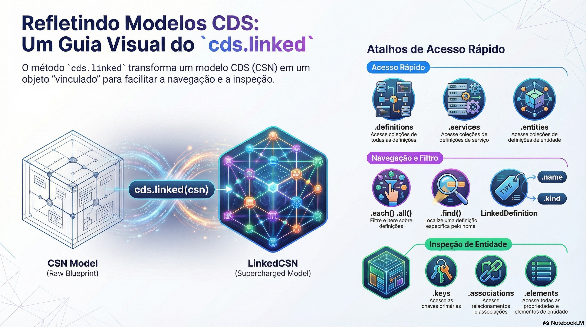

# Reflexão com cds.linked

> **Comece pelos slides: [Reflexão com cds.linked](./10.04_Reflexao_com_cds_linked.pptx)**
>
> **Referência oficial (Capire):** [cds.reflect](https://cap.cloud.sap/docs/node.js/cds-reflect)

Como navegar pelo modelo em tempo de execução, com definições ligadas, iteradores e classes do sistema de tipos.

## O que você vai aprender

- `cds.linked` (ou `cds.reflect`) transforma CSN em modelo navegável
- A chamada altera o próprio modelo e é **idempotente**
- `.services` e `.entities` funcionam como objetos, listas e funções
- `each`, `all`, `find` e `foreach` filtram por `kind` ou por função
- Entidades têm atalhos como `keys`, `associations`, `texts` e `drafts`
- `cds.linked.classes` expõe a hierarquia de tipos, e `mixin` a amplia

## Seções da aula

1. **cds.linked:** O próprio modelo é modificado e devolvido. Pode ser chamado de novo **sem custo extra**.
2. **Consultando definições:** Filtre por tipo ou por função, e percorra apenas o que interessa.
3. **As definições ligadas:** Cada definição ganha **propriedades de conveniência**, conforme seu tipo.
4. **O sistema de tipos:** Todas as definições são instâncias de um **conjunto de classes**, que podem ser ampliadas.

## Material complementar

- PDF: [Dominando Reflexao de Modelos](./10.04_Dominando_Reflexao_de_Modelos.pdf)
- Infográfico: [Modelo Vivo Reflexao](./10.04_Modelo_Vivo_Reflexao.png)

---

[Voltar ao Módulo 10](../README.md) · Próxima aula: [10.05 Bootstrap do servidor e cds.serve](../../modulo-10/10.05%20-%20Bootstrap%20do%20servidor%20e%20cds.serve/README.md)
